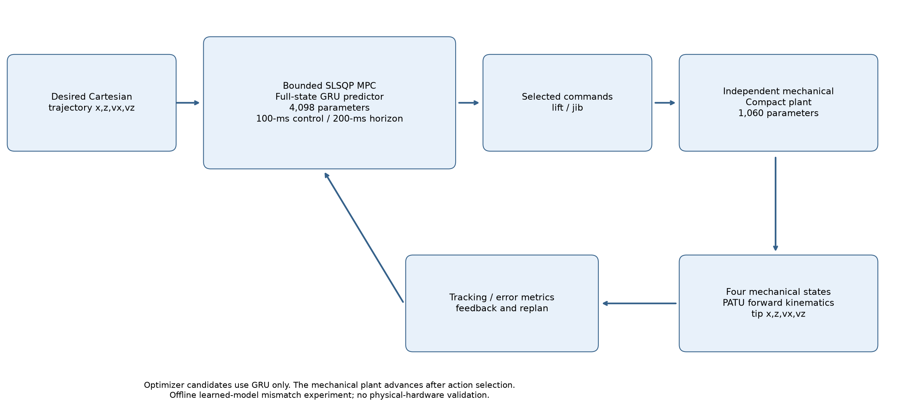

# Learned Dynamics and Offline MPC for an Electro-Hydraulic Forestry Crane

This project compares four learned full-state dynamics models and tests them in offline model predictive control (MPC). The control target is the Cartesian crane-tip trajectory: **x, z, vx, vz**.

**Final selected controller: a 4,098-parameter full-state GRU predicts inside MPC; a separate 1,060-parameter mechanical Compact Recurrent model is the independent simulated plant.** LSTM, Transformer and full-state Compact remain comparison models. The neural control policy described at the end has not been trained.



The optimizer evaluates candidate commands using the full-state predictor. Only after selecting a command does the independent mechanical plant advance. Its current mechanical state feeds back to the next solve; future measured recording states are not used to refresh the controller. Plant-generated reference replay uses the mechanical plant before optimization, but optimizer trials do not use it.

## Start here: reproduce the workflow

Use Python **3.12**. From the cloned repository root:

```powershell
git lfs install
git lfs pull
python -m venv .venv
.\.venv\Scripts\Activate.ps1
python -m pip install -r requirements.txt
python check_setup.py
python report_results.py
python view_results.py --experiment recorded
```

The last two commands show the bundled findings without the dataset or expensive optimization. `requirements-lock.txt` records the exact tested environment. For that environment, including the CPU Torch build, use `python -m pip install --extra-index-url https://download.pytorch.org/whl/cpu -r requirements-lock.txt` instead of the unpinned requirements command.

Place the raw dataset in `data/Train/` and `data/Test/`, or point the environment variables to the equivalent folders:

```powershell
$env:IMOTION_DATA_ROOT = (Resolve-Path ".\data").Path
$env:IMOTION_PREPROCESSED_DIR = Join-Path $env:IMOTION_DATA_ROOT "preprocessed"
python check_setup.py --data --test-only
```

For inference with the shipped checkpoints, only `data/Test/Simulation_Output_53.csv` is needed. Evaluation/MPC automatically prepares that recording with the checkpoint's training-only scaler and reuses a shared test cache. Full preprocessing of the training set is optional unless training new models.

To reproduce the shipped checkpoints' training setup, use the original data split: training recordings `Simulation_Output_00.csv` through `Simulation_Output_42.csv`, with `Simulation_Output_53.csv` held out in `Test/`. The preflight checks original training filenames and required headers. Other test recordings can be evaluated with `--test-file`. A different training dataset will not reproduce the numerical tables below merely by using the same code.

To evaluate the models over the whole retained test recording:

```powershell
python evaluate_controller_horizon.py --controller-horizon 20 --no-show
python compare_models.py --controller-config "MPC offline Model/configs/final_gru_mpc.json" --controller-horizon 20 --saved-only
```

The first command computes missing local forecasts; the second loads them and opens individual model/state figures. Omit `--no-show` to open the overview and persistence figures. New generated results are ignored by Git.

The short **200 internal-step / 2-ms diagnostic** is separate:

```powershell
python compare_models.py --reinit-every 200 --no-show
python summarize_comparison.py --reinit-every 200
```

Run the final experiments with every frozen controller setting, including exact command bounds:

```powershell
python reproduce_mpc.py --experiment reachable --no-show
python reproduce_mpc.py --experiment recorded --no-show
python consolidate_mpc.py --runs "MPC offline Model/results/reachable" "MPC offline Model/results/recorded" --comparison references
```

`recorded` passes `--allow-reference-mismatch`; the reproduction diagnostic is still saved. These full runs take roughly 15-20 minutes each on the measured CPU and generate about 2.8 GB per run. Runtime depends on the machine and solver behaviour. Run serially for comparable timing. Existing nonempty output folders are refused; choose a fresh `--output-dir` rather than overwrite artifacts.

The corresponding core commands are:

```powershell
python "MPC offline Model/offline_mpc.py" --checkpoint "GRU Latent/artifacts/best_model.pt" --full-recording --tracking-space cartesian --reference-mode plant-generated --block-steps 10000 --horizon 2 --moves 2 --maxiter 5 --lift-bounds -0.9999999723274773 1.0000032089789734 --jib-bounds -0.9999999978489263 1.00000154537254 --output-dir "MPC offline Model/results/reachable" --no-show
python "MPC offline Model/offline_mpc.py" --checkpoint "GRU Latent/artifacts/best_model.pt" --full-recording --tracking-space cartesian --reference-mode recorded --allow-reference-mismatch --block-steps 10000 --horizon 2 --moves 2 --maxiter 5 --lift-bounds -0.9999999723274773 1.0000032089789734 --jib-bounds -0.9999999978489263 1.00000154537254 --output-dir "MPC offline Model/results/recorded" --no-show
```

The remaining core defaults now match the selected configuration. `reproduce_mpc.py --experiment recorded --print-command-only` prints all flags explicitly without launching optimization.

Reopen results without solving again:

```powershell
python report_results.py --section final
python report_results.py --section replay
python view_results.py --experiment reachable
python view_results.py --experiment recorded
python "MPC offline Model/offline_mpc.py" --plot-results "MPC offline Model/results/recorded"
```

The first four use small bundled tables/figure exports. The last requires a completed local run and its generated arrays, and supports full-resolution interactive time plots. Plot windows remain open until closed.

## Data and system

| Setting | Value |
| --- | --- |
| Held-out recording | Simulation_Output_53.csv |
| Startup trim | 18 seconds / 1,800,000 rows |
| Retained interval | Approximately 18-100 s |
| Retained rows | 8,200,001 |
| Measured initialization rows | 2 |
| Scored targets | 8,199,999, including the final partial block |
| Internal sampling interval | 10 microseconds |
| Full-state signals | 22 physical states plus lift/jib commands |
| Full-state model features | Current 24 signals and their recent changes: 48 features |
| Mechanical plant features | Four mechanical states, two commands, and six recent changes: 12 features |

The mechanical states are lift angle, jib angle, lift angular velocity and jib angular velocity. Models predict residual increments and add them to the current state. Full-state models output 22 increments; the independent plant outputs four.

Normalization is fitted on training portions only. Physical reconstruction is **normalized x standard deviation + mean**. The corrected activity selector uses that same expression. Training uses per-recording prefixes; validation uses the remaining suffixes, and the held-out test recording is excluded from fitting/training.

**Centered Savitzky-Golay command smoothing is retained offline preprocessing. Deployment causality is not claimed.** The two-second validation supplies known preprocessed command preview at the original sampling rate. MPC instead evaluates its candidate held-command plans. These input assumptions are explicitly different.

[Dataset columns, setup and training](docs/RUNNING.md) describes the CSV schema and optional training entrypoints. No models were retrained during experimental consolidation.

## PATU crane geometry

```text
base = (-0.09, 1.4261) m
lift_vector = (2.886080943, 0.019892554) m
jib_vector = (2.035, 0.245) m
elbow = base + R(lift_absolute_angle) @ lift_vector
tip = elbow + R(jib_absolute_angle) @ jib_vector
```

Lift and jib angles are absolute world-horizontal orientations. The full local vectors contain the geometric offsets; no extra offset is added. Forward kinematics produces elbow and tip x/z, and the analytic velocity transformation produces vx/vz. Geometry is stored in `MPC offline Model/geometry_patu.json`. Slew, flexibility and physical-hardware calibration are outside this planar experiment.

## Main surrogate comparison: two-second recursive prediction

The saved controller interval is **100 ms**. Validation spans **20 controller intervals = 2 s = 200,000 internal samples**. Each block starts from two measured rows and reset memory, with no measured-state refresh inside the block. All retained targets are scored: 41 reset blocks, including a 199,999-prediction final block. The Transformer uses causal attention and a capped history window; no future states are provided.

| Model | Lift angle RMSE [rad] | Jib angle RMSE [rad] | Lift velocity RMSE [rad/s] | Jib velocity RMSE [rad/s] |
| --- | --- | --- | --- | --- |
| GRU | 0.00267003 | 0.00419828 | 0.00434339 | 0.00561563 |
| LSTM | 0.00304465 | 0.00475421 | 0.00398889 | 0.00561928 |
| Transformer | 0.00340935 | 0.00841001 | 0.00503473 | 0.00952408 |
| Compact Recurrent | 0.00210751 | 0.00235846 | 0.00321849 | 0.00379230 |
| Persistence | 0.0185170 | 0.0234549 | 0.00611215 | 0.00979436 |

Persistence holds the initial measured state fixed for each forecast block. Compact has the best standalone mechanical prediction metrics on this selected held-out recording. Its historical training curriculum differs from the newer recurrent/Transformer trainers; this is not a claim of identical training objectives or universal architectural superiority.


Exact endpoint statistics use 819 complete control intervals: 41 endpoints at leads 1-19 and 40 at the full two-second lead. The partial final interval remains included in all-sample metrics. Time-plot bin means/min/max envelopes consume every sample; metric scores are not display-thinned.

The 200-internal-step test is only **2 ms**, and the earlier 20-sample test only **0.2 ms**. Frequent measured resets leave little time for error growth; R2 values rounded near one do not establish useful long-horizon accuracy. [All three durations](docs/results/forecast_duration_comparison.csv) show this using unchanged checkpoints. The two-second test is conditional dynamics validation, not a new two-second MPC optimization experiment.

## Selecting the MPC prediction model

GRU and full-state Compact were tested with identical initial conditions, byte-identical reachable references and the same independent mechanical plant. Both full-recording runs used 100-ms commands, a 200-ms horizon, two move blocks, maxiter=5, and identical geometry, cost/scales and exact bounds.

| Metric | GRU | Full-state Compact |
| --- | --- | --- |
| Parameters | 4,098 | 4,246 |
| Tip-position RMSE [mm] | 18.674 | 40.328 |
| Tip-position MAE [mm] | 17.294 | 35.669 |
| Maximum tip error [mm] | 28.019 | 66.944 |
| Final tip error [mm] | 26.842 | 63.807 |
| Mechanical RMS NRMSE | 0.045866 | 0.068704 |
| Mean solve time [ms] | 1,113.33 | 964.06 |
| Solver success [%] | 0.976 | 6.829 |

Compact was 13.4% faster on average, but its Cartesian position RMSE was 116% higher and aggregate mechanical tracking error 49.8% higher. **GRU was selected for MPC.** Compact had better standalone recursive prediction here; GRU performed substantially better when embedded in the optimization loop. This result does not establish that Compact is globally worse, and the cause of this transfer gap has not been isolated.

Mechanical RMS NRMSE is the RMS of four per-state RMSE/training-standard-deviation ratios, not a mixture of radians and rad/s. [Complete predictor comparison](docs/results/mpc_predictor_comparison.csv) and [percentage differences](docs/results/mpc_predictor_differences.csv) include timing, saturation and mismatch metrics.

## Optimizer iteration study

The GRU study used the same five-second segment for all three limits: `--start-seconds 38.10001` relative to retained data, corresponding to CSV time 56.10001-61.10001 s. Both booms move meaningfully. Existing short-episode metrics score control endpoints; the scope is identical across these three runs.

| Maxiter | Tip RMSE [mm] | Solver success [%] | Mean solve [ms] | p95 [ms] |
| --- | --- | --- | --- | --- |
| 5 | 5.925 | 48 | 1,153.7 | 1,910.6 |
| 10 | 6.418 | 84 | 1,677.3 | 3,999.2 |
| 20 | 5.886 | 92 | 2,107.9 | 7,738.6 |


More iterations strongly increased formal convergence but did not materially improve Cartesian tracking. Twenty iterations reduced position RMSE by only 0.66% relative to five, while mean solve time increased about 83%. **Maxiter=5 was retained.** When SLSQP reaches its limit, the existing controller selects the best finite bounded evaluated candidate, including hold, warm-start and finite-difference probe candidates. `solver_success=False` therefore does not mean no command was produced; it still limits claims of optimizer convergence.

These profiles reproduce the saved study, and never run automatically:

```powershell
python reproduce_mpc.py --experiment gru_compare --no-show
python reproduce_mpc.py --experiment compact_compare --no-show
python reproduce_mpc.py --experiment iteration5 --no-show
python reproduce_mpc.py --experiment iteration10 --no-show
python reproduce_mpc.py --experiment iteration20 --no-show
```

## Final Cartesian MPC experiments

Both final experiments use the selected GRU and fixed controller settings. Each completes 820 updates and scores all 8,199,999 internal samples. Controller settings, initialization and replay conditions were verified identical; only the desired reference and its reproduction-gate override differ.

### Reachable plant-generated reference

Recorded commands are replayed through the independent mechanical Compact plant, producing a reachable mechanical trajectory that PATU kinematics converts to a Cartesian target. MPC receives target preview, not the generating future commands. This isolates control performance inside a learned-model mismatch experiment; it is not physical-hardware validation.


### Recorded physical trajectory: model/reference mismatch

The recorded trajectory is used directly despite imperfect recorded-command reproduction by the mechanical plant. The question is whether MPC can choose a different command sequence that tracks that desired motion better than replay. Replay failure does not establish mathematical unreachability. The explicit mismatch flag allows this experiment while preserving the diagnostic.


| All-internal-sample metric | Reachable reference | Recorded reference |
| --- | --- | --- |
| Tip-position RMSE [mm] | 18.674 | 26.085 |
| MAE [mm] | 17.294 | 21.298 |
| Maximum error [mm] | 28.019 | 79.115 |
| Final error [mm] | 26.842 | 6.994 |
| Mean solve [ms] | 1,116.0 | 1,111.9 |
| Solver success [%] | 0.976 | 19.878 |
| Lift saturation [%] | 12.683 | 56.098 |
| Jib saturation [%] | 25.854 | 33.415 |

These columns score different desired trajectories; their difference is not an algorithm improvement.

The replay-versus-MPC comparison uses **matching control endpoints**, because the saved reproduction diagnostic stores endpoints. Primary MPC metrics above still score every internal sample. This explains the small rounding difference in recorded-reference RMSE below.

| Endpoint position metric | Held recorded-command replay | GRU MPC | Improvement |
| --- | --- | --- | --- |
| RMSE [mm] | 108.129 | 26.086 | 75.88% |
| MAE [mm] | 99.883 | 21.303 | 78.67% |
| Maximum error [mm] | 172.170 | 79.090 | 54.06% |
| Final error [mm] | 133.231 | 6.994 | 94.75% |

Lift- and jib-angle RMSE improved 76.3% and 77.2%. Lift-velocity RMSE improved only 0.8%, and vertical tip-velocity RMSE only 0.65%. MPC strongly improved position tracking relative to replay, but velocity tracking remained difficult and the recorded-reference task required much more lift saturation. These are simulations using an independent learned mechanical plant, not measured crane responses to the selected MPC commands.

[Final full table](docs/results/final_gru_reference_comparison.csv), [matching endpoint replay comparison](docs/results/recorded_replay_vs_mpc.csv), [reachable coverage](docs/results/mpc_reachable_coverage.json) and [recorded coverage](docs/results/mpc_recorded_coverage.json) contain the full numerical evidence.

## Final frozen MPC configuration

**Predictor: full-state GRU, 4,098 parameters. Plant: independent mechanical Compact Recurrent, 1,060 parameters. Tracking: Cartesian x,z,vx,vz. Internal timestep: 10 microseconds. Command interval: 100 ms. Horizon: 200 ms. Move blocks: two. Optimizer: bounded SLSQP, maxiter=5.**

Position/velocity scales are 0.01 m and 0.1 m/s. Cartesian position, velocity, terminal-position and terminal-velocity weights are 1, 0.1, 5 and 1. Effort is 0.0001, smoothness 0.001, finite-difference step 0.03 and ftol 1e-8. Joint objective weights are zero in Cartesian mode. [The portable frozen configuration](MPC%20offline%20Model/configs/final_gru_mpc.json) records all exact bounds and checkpoint hashes.

**This is an offline MPC teacher, not a real-time online controller. Every solve exceeded the 100-ms interval.** Formal convergence and predicted-cost improvement over holding the previous command are separate from plant tracking accuracy. Optimizer timing excludes kernel compilation and does not imply deadline compliance.

## Repository map and result policy

```text
project/
  Data Preprocessing/preprocess_dataset.py
  GRU Latent/                 final GRU predictor, trainer, test, artifacts
  LSTM/                       comparison model, trainer, test, artifacts
  Transformers/               comparison model, trainer, test, artifacts
  Compact Recurrent/          full-state comparison model and artifacts
  MPC offline Model/
    offline_mpc.py             Cartesian MPC
    crane_kinematics.py        FK and analytic velocities
    geometry_patu.json         exact PATU vectors
    configs/final_gru_mpc.json frozen scientific settings
    plant/                    independent mechanical model, trainer and test
    artifacts/mechanical_plant/
  compare_models.py
  evaluate_controller_horizon.py
  summarize_comparison.py
  reproduce_mpc.py            explicit frozen experiment profiles
  consolidate_mpc.py          summarize regenerated local runs
  check_setup.py              dependencies, checkpoints and dataset preflight
  report_results.py           print bundled tables without the dataset
  view_results.py             open bundled publication figures
  docs/figures/               curated final figures
  docs/results/               lightweight published numerical evidence
  README.md
```

Checkpoint files and existing exported inference weights retain Git LFS tracking. Raw data, prepared caches, environments, Python caches, generated prediction arrays, local experiments and archived overwritten runs are ignored. Large generated result trees are no longer part of the current publication tree; their original local copies and Git history remain intact. A new clone downloads the trained artifacts and curated summaries/figures, then regenerates arrays from the dataset when needed. Historical LFS objects in prior commits are not rewritten or deleted by this cleanup.

## What happens next

The MPC configuration is now frozen. The next research stage is to:

1. Generate many MPC-controlled trajectories under varied initial states and references.
2. Save teacher examples: current state, desired future trajectory, previous command and selected command.
3. Train a lightweight neural policy to approximate the MPC mapping.
4. Compare its commands against MPC commands.
5. Test the learned controller on the independent mechanical plant.
6. Later validate against a higher-fidelity simulator and physical crane.

The aim is to replace expensive online optimization with a fast learned policy while retaining behaviour learned from the offline MPC teacher. **No neural controller has been trained or validated yet.**
