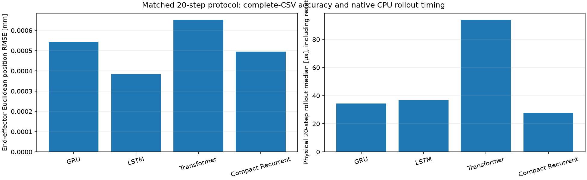
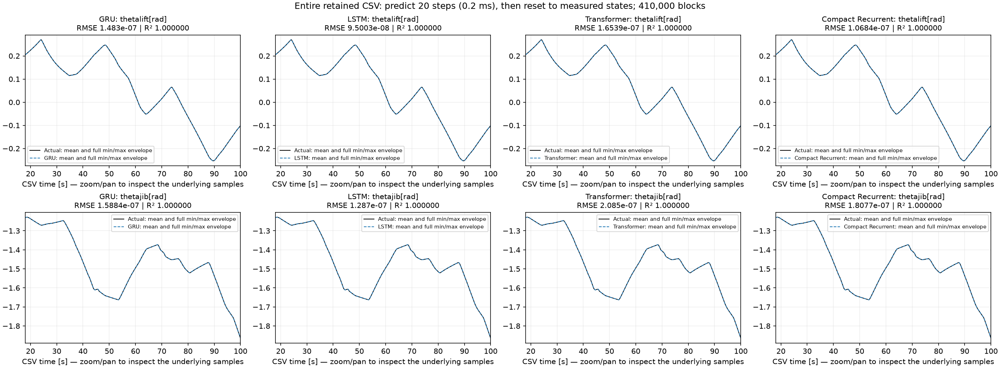
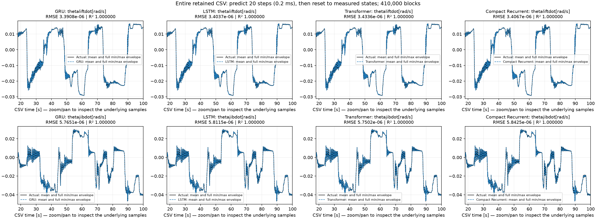
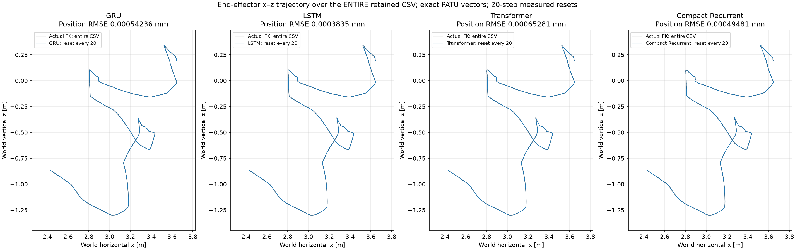
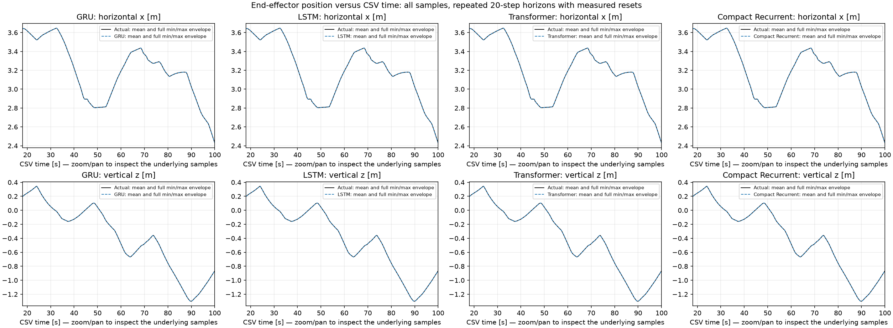

# Data-Driven Modeling and MPC for Electro-Hydraulic Cranes

**GRU · LSTM · Transformer · Compact Recurrent**

The main analysis uses **20 recursive prediction steps, then resets from measured
states**, repeated across the **entire retained CSV**. It does not use one 82-second
continuous prediction as the main comparison. Full-recording plots below show all
recorded samples after the unchanged 18-second startup trim.

## Exact evaluation protocol

| Setting | Value |
| --- | --- |
| Held-out recording | Simulation_Output_53.csv |
| Sample time | 10 µs |
| Prediction horizon before reset | 20 samples = 0.2 ms |
| Predictions scored per model | 8,199,999 |
| Reset blocks | 410,000 |
| Last block | 19 predictions |
| CSV time range shown | 18.000020 to 100.000000 s |
| Reset state | Two measured physical-state rows; recurrent memory reset |
| Inside each prediction block | Commands plus recursively predicted states; no future measured states |

The recording is traversed once from beginning to end. Every block starts from
measured states, so this is short-horizon surrogate validation throughout the CSV,
not an autonomous full-recording rollout. All architectures use identical targets,
normalization, command alignment, reset boundaries, CPU and native float32 kernels.
The Transformer starts with empty history at each reset; history grows within the
20-step block. GRU and LSTM also reset their memory at every block.

## Whole-CSV comparison results

| Model | Parameters | Mean NRMSE, 22 states | End-effector position RMSE [µm] | Physical 20-step median [µs] |
| --- | --- | --- | --- | --- |
| GRU | 4,098 | 4.098413e-05 | 0.542362 | 34.3 |
| LSTM | 4,946 | 4.0901243e-05 | 0.383496 | 36.7 |
| Transformer | 4,710 | 4.1768868e-05 | 0.652814 | 94.0 |
| Compact Recurrent | 4,246 | 4.0034427e-05 | 0.494815 | 27.8 |



LSTM has the lowest derived Cartesian position RMSE in this test. Compact Recurrent
has the lowest mean normalized error across all 22 states and the fastest measured
20-step rollout. Differences are small at this very short prediction interval.
Timing includes physical input normalization, memory initialization, all twenty
prediction steps, and output reconstruction. Full-context warm one-step benchmarks
remain separate in the saved reports and are not used as the matched-horizon timing.

The Cartesian errors are derived from recorded and predicted angles using the same
kinematics. They are not independent physical tip measurements or evidence of
micrometre accuracy on a real crane. At 10 µs sampling, even twenty steps spans
only 0.2 ms; the saved persistence baseline and error by lead step are important
context. Compact retains its historical different training curriculum, which is
documented in the comparison provenance.

### Lift and jib angles over the entire CSV



### Lift and jib angular velocities over the entire CSV



Every sample contributes to the plot's bin mean and min/max envelope. The lines
are not limited to the first twenty samples or a short selected episode. Interactive
plots reload the visible samples when zooming, and show each point when sufficiently
zoomed in. All predictions are saved at their original sample rate.

## End-effector trajectory over the entire CSV

Exact PATU planar geometry is used for each actual and predicted mechanical state:

```text
base = (-0.09, 1.4261) m
lift_vector = (2.886080943, 0.019892554) m
jib_vector = (2.035, 0.245) m
p_elbow = base + R(theta_lift_absolute) @ lift_vector
p_tip = p_elbow + R(theta_jib_absolute) @ jib_vector
```

The local vectors already include geometric offsets; no additional offsets are
added. Both recorded angles are absolute. Cartesian velocities use the analytic
Jacobian and recorded/predicted angular velocities.



This is the actual-recording FK path versus each surrogate's reset-20 predicted
path. The plotted trajectory traverses the whole retained CSV. Bin bounding boxes
include all samples; the mean path is the visible line. Actual and predicted curves
largely overlap at this short horizon. This figure is a **model validation trajectory**,
not a closed-loop MPC plant trajectory.



[State metrics](docs/results/reset20_all_state_metrics.csv) ·
[end-effector metrics](docs/results/reset20_end_effector_metrics.csv) ·
[error by prediction step 1–20](docs/results/reset20_metrics_by_prediction_step.csv) ·
[full-CSV coverage](docs/results/reset20_recording_coverage.csv) ·
[summary including persistence](docs/results/reset20_model_summary.csv) ·
[geometry and protocol provenance](docs/results/reset20_provenance.json).

## Run the same comparison and open plots

From the repository root, after configuring the dataset paths:

```powershell
python compare_models.py --test-file "Simulation_Output_53.csv" --reinit-every 20 --saved-only
```

This prints the full-recording comparison and opens 88 separate model/state figures
plus a full-recording error-over-time figure. The default mode is the reset-only
comparison; continuous rollout is not run unless explicitly requested. `--no-show`
saves figures without opening windows. For a new held-out CSV, omit `--saved-only`
to evaluate missing results over its whole retained recording.

Individual model tests also default to 20-step recursive resets over the full CSV:

```powershell
python "GRU Latent/test.py" --reinit-every 20
python "LSTM/test.py" --reinit-every 20
python "Transformers/test.py" --reinit-every 20
python "Compact Recurrent/test.py" --reinit-every 20
```

Training entrypoints are `GRU Latent/gru.py`, `LSTM/LSTM.py`,
`Transformers/transformer.py`, and `Compact Recurrent/trainCompactLatent.py`.
The small legacy import shims and checkpoint format identifiers preserve access
to the existing trained artifacts; public model labels are GRU and LSTM.

## Offline Cartesian MPC over the entire recording

MPC uses a full-state GRU predictor and a separately trained mechanical Compact
plant. Forward kinematics converts predicted boom states to an end-effector
position/velocity objective. The optimizer selects commands; the independent
plant advances only after an action is committed. Mechanical feedback corrects
the predictor without refreshing future recorded hydraulic/electrical states.

```powershell
python "MPC offline Model/offline_mpc.py" --full-recording --test-file "Simulation_Output_53.csv" --tracking-space cartesian --reference-mode plant-generated --output-dir "MPC offline Model/results/full_csv_patu" --overwrite
```

This runs over every retained sample and saves every internal mechanical and
end-effector state. It preserves the controller's configured prediction horizon
and 1-ms held-control interval. The full-CSV controller experiment has **not yet
been completed**: it requires about 82,000 optimizer solves and can take many hours.
No short-episode MPC plot is presented here as full-recording control performance.

The twenty-step measured-reset model test and closed-loop MPC are different
experiments. MPC feedback comes from the controlled plant; resetting it to a
different-command recording would invalidate that control experiment. The
controller's `--horizon` counts control intervals, whereas the model test's
`--reinit-every 20` counts 10-µs internal samples.

[Full-recording methodology and MPC commands](docs/FULL_RECORDING.md) ·
[Cartesian MPC and PATU geometry](docs/CARTESIAN_MPC.md) ·
[dataset, preprocessing and training setup](docs/RUNNING.md).

## Dataset and artifacts

Raw recordings belong in Train/ and Test/. Keep the existing 18-second trim and
training-only normalization. Set `IMOTION_DATA_ROOT` and `IMOTION_PREPROCESSED_DIR`
as described in the running guide. Centered command smoothing is an offline
preprocessing operation and is retained for consistency with the trained models.
Two initialization rows are measured rather than predicted.

All four completed checkpoints are included. Large prediction arrays and numerical
archives use Git LFS. No model was retrained for this analysis. Every model's
reset-20 predictions were recomputed over the complete retained recording, and
the native batched reset kernel was checked against the original per-block kernel,
including reset boundaries and the final incomplete block.

Older continuous-rollout, reset-500, and short MPC experiments remain available
as historical evidence in their result folders. They are not the main analysis
or the figures featured here. The current results live under each model's
`results/Simulation_Output_53/checkpoint_<hash>/recursive_reinit20/` and
`results/reset20/Simulation_Output_53/`.
