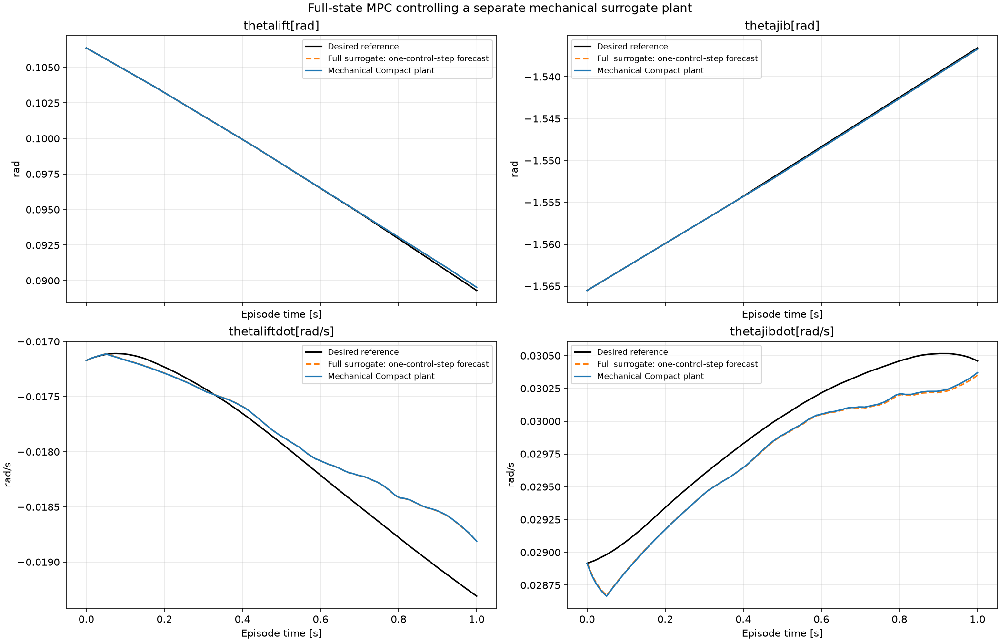
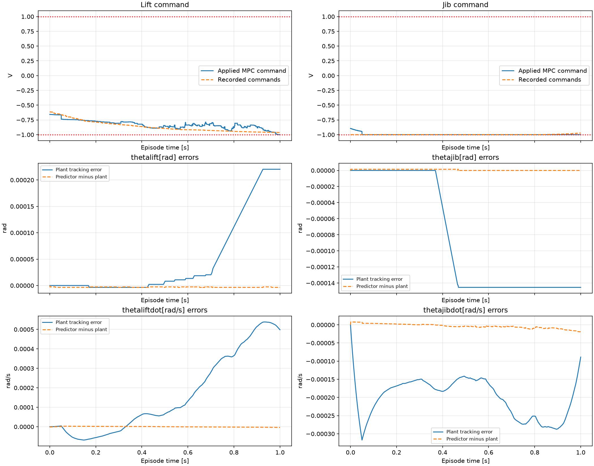
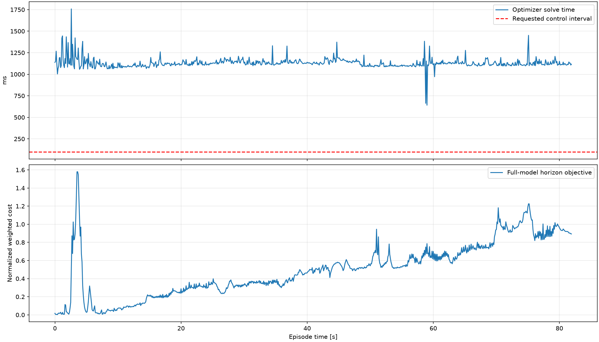
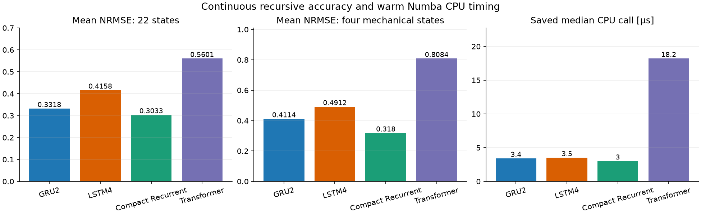
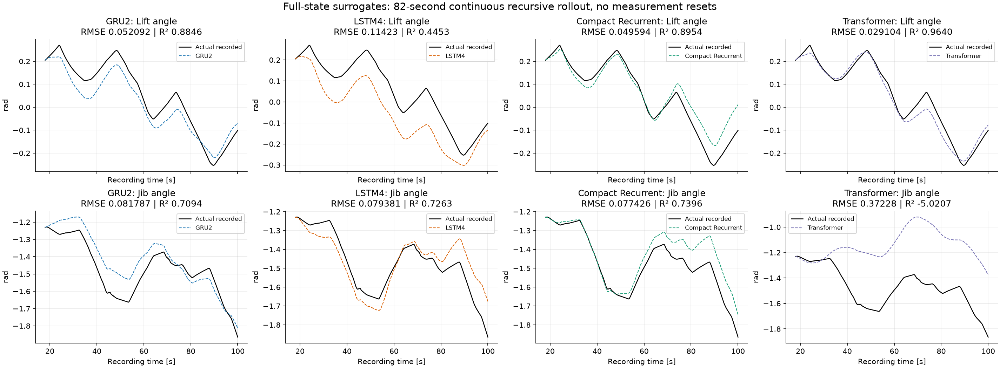
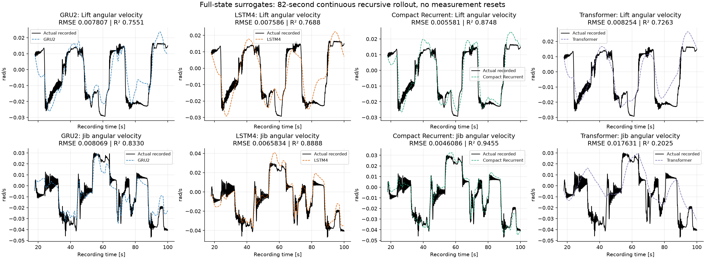

# Data-Driven Modeling and MPC for Electro-Hydraulic Cranes

Full-state neural dynamics models and offline model predictive control for an
electro-hydraulic crane. The controller uses a full-state GRU predictor and a
separately trained mechanical Compact model as its simulated plant. Cartesian
end-effector MPC uses the exact PATU geometry and both absolute boom angles;
see the [Cartesian MPC guide](docs/CARTESIAN_MPC.md). The saved one-second MPC
gallery below preserves the earlier joint-cost experiment.

**Start here:** [Run the code](docs/RUNNING.md) · [MPC tracking metrics](docs/results/mpc_tracking_metrics.csv) · [Full-state comparison metrics](docs/results/full_state_all_metrics.csv).

The physical activity selector has also been corrected and tested before/after.
See [the controlled comparison](docs/ACTIVITY_SELECTION_AB.md): fixed-start model
predictions and controls are unchanged; automatic selection chooses a different episode.

Whole-recording evaluation is now explicit. See [full CSV coverage and commands](docs/FULL_RECORDING.md). Model plots include every retained sample in min/max envelopes, and full-CSV MPC saves and scores every internal microstep. Short historical MPC episodes below remain labeled as episodes.

## Offline MPC: tracking a separate mechanical surrogate plant

The optimizer predicts 22 physical states with GRU2, chooses bounded lift/jib
commands, and applies the first action to a separate four-state mechanical plant.
The plant feeds back lift/jib angles and angular velocities. Future recorded
hydraulic or electrical states do not refresh the predictor, and the mechanical
plant is never used to score optimizer candidates.

The experiment shown below is the saved **one-second, plant-generated-reference**
run `verified_one_second_v2`: 1,000 control updates, 1 ms held-command intervals,
a 100 ms prediction horizon, and ten command move blocks.



### Tracking accuracy

These metrics compare the mechanical plant response against the desired reference;
the initial measured sample is excluded.

| Mechanical state | Unit | RMSE | MAE | R² |
| --- | --- | --- | --- | --- |
| Lift angle | rad | 8.816666e-05 | 4.789117e-05 | 0.999681 |
| Jib angle | rad | 0.0001093714 | 8.466581e-05 | 0.999830 |
| Lift angular velocity | rad/s | 0.0002564884 | 0.0001819955 | 0.868728 |
| Jib angular velocity | rad/s | 0.0002077844 | 0.0002007273 | 0.841535 |

The angles track closely in this simulated episode. Velocity tracking is less
accurate, with R² approximately 0.87 for lift and 0.84 for jib.

### Prediction accuracy and control behavior

The following mismatch compares the **uncorrected one-control-interval GRU
prediction** with the mechanical plant after the same applied action. It is a
model mismatch measurement, separate from reference tracking error.

| Mechanical state | Predictor–plant RMSE | Predictor–plant MAE |
| --- | --- | --- |
| Lift angle | 3.102071e-06 | 3.072146e-06 |
| Jib angle | 1.008451e-06 | 6.896856e-07 |
| Lift angular velocity | 1.738076e-06 | 1.500342e-06 |
| Jib angular velocity | 6.982944e-06 | 5.614624e-06 |



The jib command was at its constraint for approximately 94.7% of this run.
Low tracking error should therefore be read together with saturation and solver
behavior rather than treated as evidence of ample control margin.

### Optimizer timing

| Quantity | Saved result |
| --- | --- |
| Control interval | 1 ms |
| Prediction horizon | 100 ms |
| Control updates | 1,000 |
| Mean solve time | 915.42 ms |
| Median solve time | 547.79 ms |
| 95th percentile solve time | 2315.01 ms |
| Solver success | 99.9% |
| Missed 1 ms deadlines | 100% |
| Lift command saturation | 0.8% |
| Jib command saturation | 94.7% |



**This is an offline MPC demonstration.** The optimizer reports convergence on
99.9% of updates, but every solve exceeds the requested 1 ms control interval.
Fast surrogate inference alone does not establish real-time MPC execution.

### What this experiment establishes

The reference was generated by replaying a known held-command sequence through
the mechanical plant. It is a reachable target for that simulated plant. The
original recorded-reference reproduction gate failed on the same episode, so
this result does **not** establish equivalent tracking of the original recording.
Two independently trained neural surrogates introduce learned-model mismatch,
but do not replace validation against a physical crane or a trusted physics plant.

Full saved trajectories, command plans, solver histories, reproduction diagnostics,
and numerical arrays are in [the MPC result folder](MPC%20offline%20Model/results/verified_one_second_v2).

## Full-state surrogate comparison

GRU2, LSTM4, Transformer, and Compact Recurrent predict 22 state increments from 48 features:
current states/commands plus their recent differences. Predicted increments are
added to current states; each architecture retains a direct linear residual skip.
The small causal residual Transformer has completed 60 training epochs. Its
trained checkpoint and full-record cached evaluations are included alongside
the recurrent models.

These saved results cover the same held-out `Simulation_Output_53.csv`, with
8,199,999 predictions over approximately 82 seconds after an 18-second startup
trim. The displayed comparison is **continuous recursive rollout with no
measurement resets**. Plots use 6,000 display points; the published metrics use
every prediction row. NRMSE is RMSE divided by each state's training standard
deviation; the table reports arithmetic means across the stated features.

| Model | Parameters | Mean NRMSE, 22 states | Mean NRMSE, mechanical states | Median call, µs |
| --- | --- | --- | --- | --- |
| GRU2 | 4,098 | 0.331832 | 0.411378 | 3.40 |
| LSTM4 | 4,946 | 0.415755 | 0.491226 | 3.50 |
| Compact Recurrent | 4,246 | 0.303304 | 0.317991 | 3.00 |
| Transformer | 4,710 | 0.560138 | 0.808358 | 18.20 |



In this recording, Compact Recurrent has the lowest average normalized rollout
error and lowest saved median call time. GRU2 improves the average rollout error
over LSTM4 and Transformer, although the individual-state ranking varies. This is a comparison
of the existing trained checkpoints: Compact used a different historical training
curriculum and checkpoint-selection objective. Saved timing benchmarks were
collected at different times and use warm Numba float32 CPU kernels; they are
not a new synchronized hardware benchmark.





### Mechanical-state rollout metrics

Angle errors are in rad; angular-velocity errors are in rad/s.

| Model | Mechanical state | RMSE | MAE | R² |
| --- | --- | --- | --- | --- |
| GRU2 | Lift angle | 0.0520917 | 0.0479938 | 0.884647 |
| GRU2 | Jib angle | 0.0817872 | 0.0699248 | 0.709412 |
| GRU2 | Lift angular velocity | 0.00780696 | 0.00610223 | 0.755104 |
| GRU2 | Jib angular velocity | 0.00806903 | 0.00662263 | 0.832971 |
| LSTM4 | Lift angle | 0.114231 | 0.105032 | 0.445300 |
| LSTM4 | Jib angle | 0.0793814 | 0.0643286 | 0.726256 |
| LSTM4 | Lift angular velocity | 0.00758595 | 0.00598472 | 0.768773 |
| LSTM4 | Jib angular velocity | 0.00658341 | 0.00550945 | 0.888814 |
| Compact Recurrent | Lift angle | 0.0495939 | 0.0364474 | 0.895444 |
| Compact Recurrent | Jib angle | 0.0774265 | 0.0571931 | 0.739573 |
| Compact Recurrent | Lift angular velocity | 0.00558097 | 0.00435992 | 0.874848 |
| Compact Recurrent | Jib angular velocity | 0.00460857 | 0.00372724 | 0.945514 |
| Transformer | Lift angle | 0.0291036 | 0.0224616 | 0.963993 |
| Transformer | Jib angle | 0.37228 | 0.330936 | -5.020690 |
| Transformer | Lift angular velocity | 0.00825405 | 0.00652647 | 0.726251 |
| Transformer | Jib angular velocity | 0.0176312 | 0.0130742 | 0.202532 |

The full [metric CSV](docs/results/full_state_all_metrics.csv) also includes
measured-input one-step errors, maximum absolute error, normalized RMSE, and a
persistence baseline. Tiny errors at a 10 µs one-step interval should be assessed
against that baseline and the recursive rollout, rather than interpreted as proof
of long-horizon accuracy. Matched reset-500 evaluations are also available for all
four models. Historical reset-20 Compact results are retained separately and are
not combined with reset-500 results in a ranking.

## Run the project

Python 3.12 was used for package checks. Install dependencies in your own virtual
environment:

```powershell
python -m venv .venv
& ".\.venv\Scripts\python.exe" -m pip install -r requirements.txt
```

Use that environment's Python for the commands below. Raw data must contain
`Train/` and `Test/` directories; the [running guide](docs/RUNNING.md) lists all
required CSV columns, preprocessing settings, training flags, and folder layouts.

```powershell
$env:IMOTION_DATA_ROOT = "D:\YourDataset\CSV"
python "Data Preprocessing/preprocess_dataset.py"
```

View the saved MPC results immediately, without the dataset or re-solving:

```powershell
python "MPC offline Model/offline_mpc.py" --plot-results "MPC offline Model/results/verified_one_second_v2"
```

Run a new offline MPC experiment:

```powershell
python "MPC offline Model/offline_mpc.py" --full-recording --reference-mode plant-generated
```

Compare all four models using the existing saved evaluations:

```powershell
python compare_models.py --reinit-every 500 --saved-only
```

The comparison reuses matching saved evaluations and computes missing evaluations
once. Its default opens **88 separate actual-versus-prediction windows**: four
models × 22 states for the reset-500 scenario. Close all windows to finish, or
add `--no-show` to save plots only.

## Repository contents and reproducibility

- `Data Preprocessing`: training-only normalization and CSV conversion.
- `Transformers`, `GRU Latent`, `LSTM`, `Compact Recurrent`: trainers, evaluators,
  model artifacts, and saved result folders.
- `MPC offline Model`: controller, recorded-reference reproduction helpers,
  independent mechanical plant, artifacts, and historical MPC results.
- `common`: shared loading, evaluation, and portable path utilities.
- `docs`: comparison plots, tables, provenance, and complete running instructions.

Checkpoint weights and saved prediction arrays were copied unchanged.
`package_manifest.json` records hashes and packaging checks. Dataset paths are
configurable; embedded historical training paths are resolved by recording name
against the selected prepared dataset. Training, short evaluation, 88 comparison
plots, saved-MPC plotting, and a three-action MPC integration were checked during
packaging. These checks are not a new full training or full accuracy experiment.

The saved prediction arrays occupy approximately **19 GB** and are stored using
Git LFS, along with checkpoints and numerical archives. To clone the complete
project, install Git LFS and run:

```powershell
git lfs install
git clone https://github.com/SohaibMustafaSaeed/Data-Driven-Modeling-and-MPC-for-Electro-Hydraulic-Cranes.git
```

To obtain code and README figures without immediately downloading all LFS data,
set `GIT_LFS_SKIP_SMUDGE=1` before cloning, then fetch required artifact paths
with `git lfs pull --include="*/artifacts/**"`. Plotting the saved MPC numerical
archive additionally requires its `.npz` file.

Command preprocessing uses a centered 51-row Savitzky–Golay filter and therefore
future command samples. The reported pipeline is offline; a live causal pipeline
requires separate preparation and validation.
