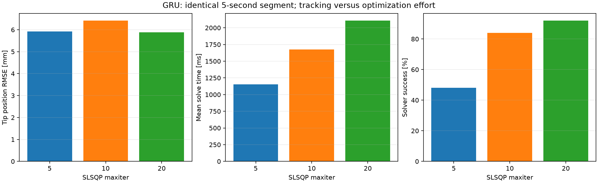
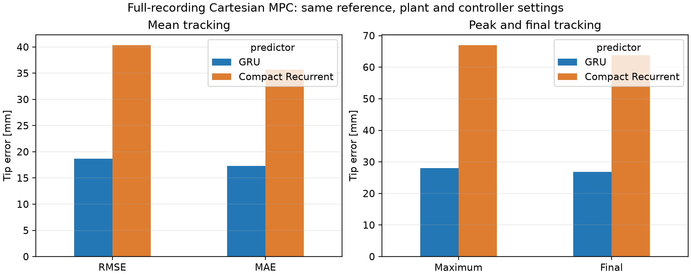
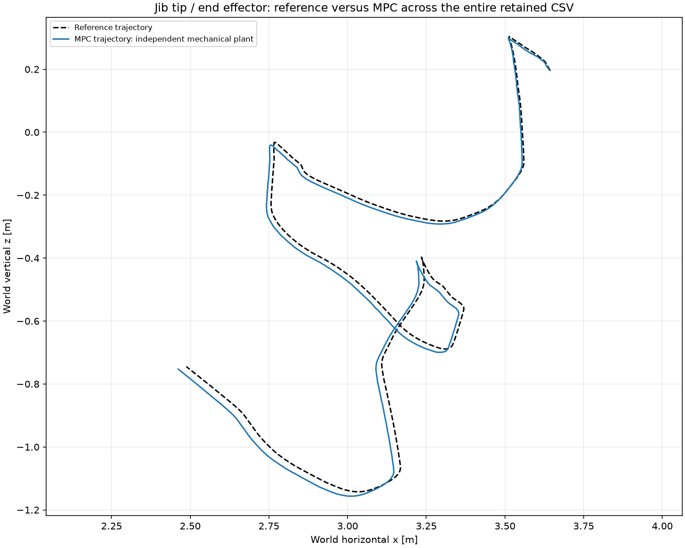
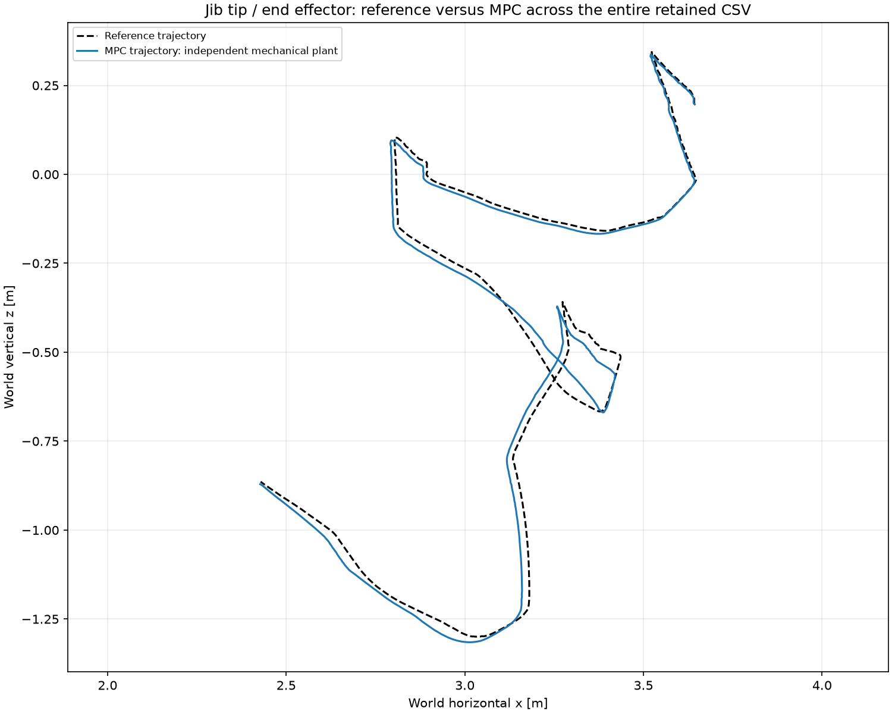
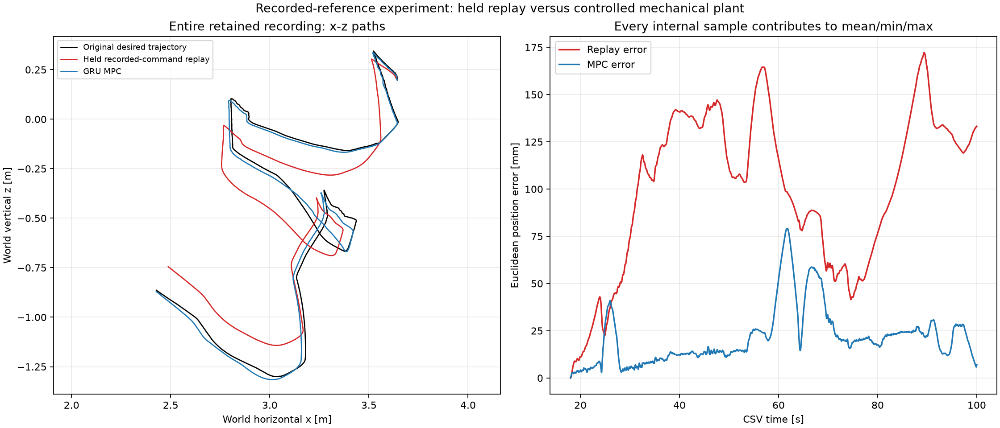
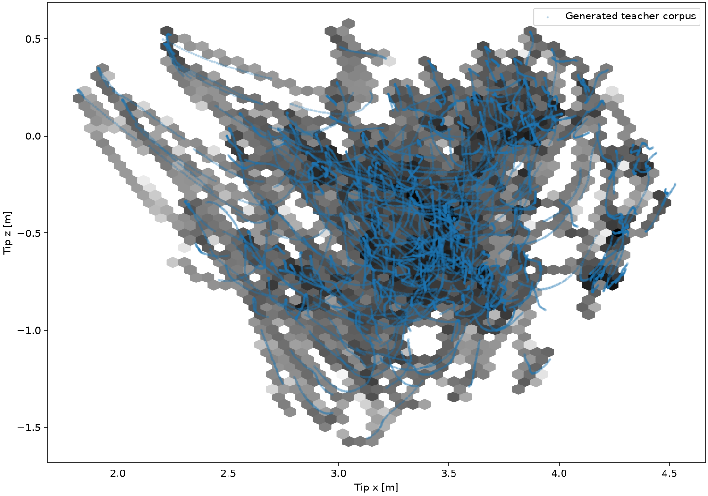
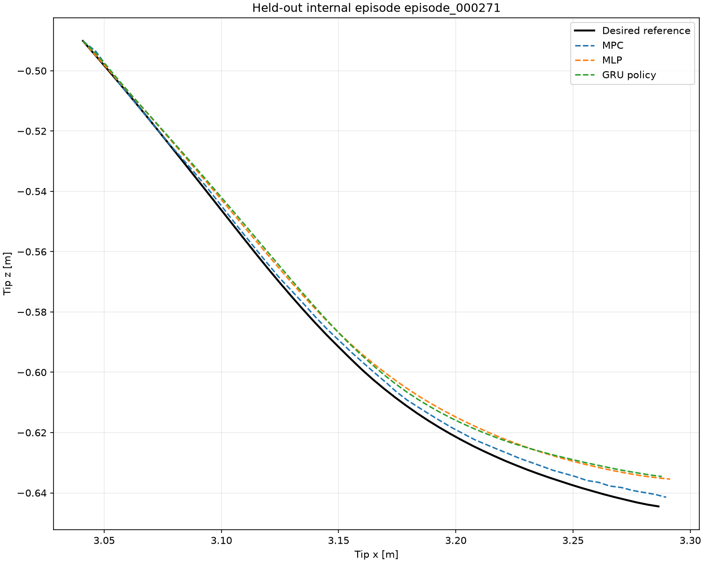
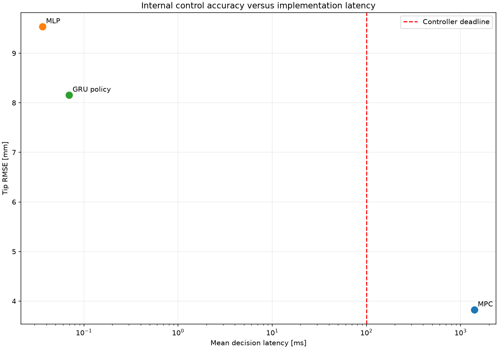
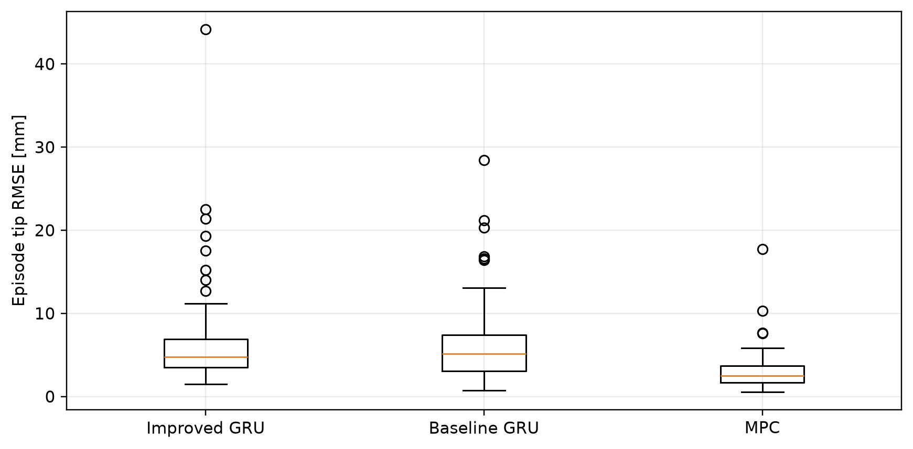

# Data-Driven Modeling and Real-Time Neural Control of an Electro-Hydraulic Forestry Crane

## Overview

This repository contains the completed study: learned full-state dynamics, offline learned-model Cartesian MPC, an independent learned mechanical validation plant, a 25,000-sample MPC teacher corpus, compact neural-policy distillation, held-out closed-loop evaluation and CPU timing.

**Final neural controller: the baseline 6,898-parameter GRU policy.** The 4,098-parameter full-state GRU inside MPC and the 1,060-parameter mechanical Compact plant have separate roles. LSTM, Transformer and full-state Compact remain dynamics comparison models. 

These are learned-model simulation results and computational-feasibility measurements. Physical crane, Simulink and hardware-controller validation remain future work.

## Research pipeline

See [the pipeline](docs/FINAL_PIPELINE.md), [the supervisor guide](docs/SUPERVISOR_GUIDE.md) and [the experiment map](docs/EXPERIMENT_MAP.md) for the complete study and evidence paths.

## Repository structure

```text
Data Preprocessing/       raw CSV preparation and training-only scaler
GRU Latent/               selected full-state dynamics predictor
LSTM/                     comparison dynamics model
Transformers/             comparison dynamics model
Compact Recurrent/        full-state comparison model
MPC offline Model/        Cartesian MPC, PATU geometry, independent mechanical plant
Neural Controller/        teacher generation, policies, frozen splits, results, ablation
common/                   shared loading and evaluation utilities
docs/figures/             curated supervisor/publication figures
docs/results/             lightweight authoritative result tables
archive_working_repository/ local ignored development archive; retained for review
```

## Installation

Use Python 3.12 and fetch the Git LFS checkpoints:

```powershell
git lfs install
git lfs pull
python -m venv .venv
.\.venv\Scripts\Activate.ps1
python -m pip install -r requirements.txt
python check_setup.py
```

`requirements-lock.txt` records the original measured environment. To reproduce its CPU Torch build, use `python -m pip install --extra-index-url https://download.pytorch.org/whl/cpu -r requirements-lock.txt`.

## Dataset setup

Raw data is not distributed. Use `data/Train/Simulation_Output_00.csv` through `Simulation_Output_42.csv`. The existing dynamics/MPC test is `data/Test/Simulation_Output_53.csv`. Neural teacher generation and neural internal validation use only the training recordings, with separate complete source-recording groups. External Test is prohibited in neural-stage scripts.

For another data location:

```powershell
$env:IMOTION_DATA_ROOT = "D:\crane_data"
$env:IMOTION_PREPROCESSED_DIR = "D:\crane_data\preprocessed"
```

The root must contain `Train/`; `Test/` is required only for the separate existing surrogate/MPC test. Neural scripts also accept `--data-root`, `--preprocessed-dir`, `--dataset-dir` or `--output-dir` as listed by `--help`. Set `MPC_TEACHER_DATASET_DIR` for an existing complete teacher corpus. Original recording names, columns and sample ordering are required for numerical reproduction. Embedded checkpoint training paths are historical provenance; loaders resolve recording basenames under the configured directories.

## Data preprocessing


| Setting | Value |
| --- | --- |
| Held-out recording | Simulation_Output_53.csv |
| Startup trim | 18 seconds / 1,800,000 rows |
| Retained interval | Approximately 18-100 s |
| Retained rows | 8,200,001 |
| Measured initialization rows | 2 |
| Scored targets | 8,199,999, including the final partial block |
| Internal sampling interval | 10 microseconds |
| Full-state signals | 22 physical states plus lift/jib commands |
| Full-state model features | Current 24 signals and their recent changes: 48 features |
| Mechanical plant features | Four mechanical states, two commands, and six recent changes: 12 features |

The mechanical states are lift angle, jib angle, lift angular velocity and jib angular velocity. Models predict residual increments and add them to the current state. Full-state models output 22 increments; the independent plant outputs four.

Normalization is fitted on training portions only. Physical reconstruction is **normalized x standard deviation + mean**. The corrected activity selector uses that same expression. Training uses per-recording prefixes; validation uses the remaining suffixes, and the held-out test recording is excluded from fitting/training.

**Centered Savitzky-Golay command smoothing is retained offline preprocessing. Deployment causality is not claimed.** The two-second validation supplies known preprocessed command preview at the original sampling rate. MPC instead evaluates its candidate held-command plans. These input assumptions are explicitly different.

[Dataset columns, setup and training](docs/RUNNING.md) describes the CSV schema and optional training entrypoints. No models were retrained during experimental consolidation.


The preprocessing script retains the original 18-second trim, 24-signal normalization, command smoothing and per-recording 90% training prefix. Its new `--training-only` switch skips Test inspection and conversion without changing training preprocessing. Centered command smoothing is an offline preparation step and has a causality limitation for deployment.

## Learned dynamics models

All four predictors reconstruct 22 next states through residual prediction from current state, state/command changes and temporal memory. Final trainers and exported inference weights remain in their original folders. The full-state Compact comparison model (4,246 parameters) is distinct from the independent mechanical-only Compact plant (1,060 parameters).

## Two-second recursive model evaluation


The saved controller interval is **100 ms**. Validation spans **20 controller intervals = 2 s = 200,000 internal samples**. Each block starts from two measured rows and reset memory, with no measured-state refresh inside the block. All retained targets are scored: 41 reset blocks, including a 199,999-prediction final block. The Transformer uses causal attention and a capped history window; no future states are provided.

| Model | Lift angle RMSE [rad] | Jib angle RMSE [rad] | Lift velocity RMSE [rad/s] | Jib velocity RMSE [rad/s] |
| --- | --- | --- | --- | --- |
| GRU | 0.00267003 | 0.00419828 | 0.00434339 | 0.00561563 |
| LSTM | 0.00304465 | 0.00475421 | 0.00398889 | 0.00561928 |
| Transformer | 0.00340935 | 0.00841001 | 0.00503473 | 0.00952408 |
| Compact Recurrent | 0.00210751 | 0.00235846 | 0.00321849 | 0.00379230 |
| Persistence | 0.0185170 | 0.0234549 | 0.00611215 | 0.00979436 |

Persistence holds the initial measured state fixed for each forecast block. Compact has the best standalone mechanical prediction metrics on this selected held-out recording. Its historical training curriculum differs from the newer recurrent/Transformer trainers; this is not a claim of identical training objectives or universal architectural superiority.


Exact endpoint statistics use 819 complete control intervals: 41 endpoints at leads 1-19 and 40 at the full two-second lead. The partial final interval remains included in all-sample metrics. Time-plot bin means/min/max envelopes consume every sample; metric scores are not display-thinned.

The 200-internal-step test is only **2 ms**, and the earlier 20-sample test only **0.2 ms**. Frequent measured resets leave little time for error growth; R2 values rounded near one do not establish useful long-horizon accuracy. [All three durations](docs/results/forecast_duration_comparison.csv) show this using unchanged checkpoints. The two-second test is conditional dynamics validation, not a new two-second MPC optimization experiment.


## MPC predictor selection


GRU and full-state Compact were tested with identical initial conditions, byte-identical reachable references and the same independent mechanical plant. Both full-recording runs used 100-ms commands, a 200-ms horizon, two move blocks, maxiter=5, and identical geometry, cost/scales and exact bounds.

| Metric | GRU | Full-state Compact |
| --- | --- | --- |
| Parameters | 4,098 | 4,246 |
| Tip-position RMSE [mm] | 18.674 | 40.328 |
| Tip-position MAE [mm] | 17.294 | 35.669 |
| Maximum tip error [mm] | 28.019 | 66.944 |
| Final tip error [mm] | 26.842 | 63.807 |
| Mechanical RMS NRMSE | 0.045866 | 0.068704 |
| Mean solve time [ms] | 1,113.33 | 964.06 |
| Solver success [%] | 0.976 | 6.829 |

Compact was 13.4% faster on average, but its Cartesian position RMSE was 116% higher and aggregate mechanical tracking error 49.8% higher. **GRU was selected for MPC.** Compact had better standalone recursive prediction here; GRU performed substantially better when embedded in the optimization loop. This result does not establish that Compact is globally worse, and the cause of this transfer gap has not been isolated.

Mechanical RMS NRMSE is the RMS of four per-state RMSE/training-standard-deviation ratios, not a mixture of radians and rad/s. [Complete predictor comparison](docs/results/mpc_predictor_comparison.csv) and [percentage differences](docs/results/mpc_predictor_differences.csv) include timing, saturation and mismatch metrics.


The GRU study used the same five-second segment for all three limits: `--start-seconds 38.10001` relative to retained data, corresponding to CSV time 56.10001-61.10001 s. Both booms move meaningfully. Existing short-episode metrics score control endpoints; the scope is identical across these three runs.

| Maxiter | Tip RMSE [mm] | Solver success [%] | Mean solve [ms] | p95 [ms] |
| --- | --- | --- | --- | --- |
| 5 | 5.925 | 48 | 1,153.7 | 1,910.6 |
| 10 | 6.418 | 84 | 1,677.3 | 3,999.2 |
| 20 | 5.886 | 92 | 2,107.9 | 7,738.6 |



More iterations strongly increased formal convergence but did not materially improve Cartesian tracking. Twenty iterations reduced position RMSE by only 0.66% relative to five, while mean solve time increased about 83%. **Maxiter=5 was retained.** When SLSQP reaches its limit, the existing controller selects the best finite bounded evaluated candidate, including hold, warm-start and finite-difference probe candidates. `solver_success=False` therefore does not mean no command was produced; it still limits claims of optimizer convergence.

These profiles reproduce the saved study, and never run automatically:

```powershell
python reproduce_mpc.py --experiment gru_compare --no-show
python reproduce_mpc.py --experiment compact_compare --no-show
python reproduce_mpc.py --experiment iteration5 --no-show
python reproduce_mpc.py --experiment iteration10 --no-show
python reproduce_mpc.py --experiment iteration20 --no-show
```




## Cartesian MPC


```text
base = (-0.09, 1.4261) m
lift_vector = (2.886080943, 0.019892554) m
jib_vector = (2.035, 0.245) m
elbow = base + R(lift_absolute_angle) @ lift_vector
tip = elbow + R(jib_absolute_angle) @ jib_vector
```

Lift and jib angles are absolute world-horizontal orientations. The full local vectors contain the geometric offsets; no extra offset is added. Forward kinematics produces elbow and tip x/z, and the analytic velocity transformation produces vx/vz. Geometry is stored in `MPC offline Model/geometry_patu.json`. Slew, flexibility and physical-hardware calibration are outside this planar experiment.


**Predictor: full-state GRU, 4,098 parameters. Plant: independent mechanical Compact Recurrent, 1,060 parameters. Tracking: Cartesian x,z,vx,vz. Internal timestep: 10 microseconds. Command interval: 100 ms. Horizon: 200 ms. Move blocks: two. Optimizer: bounded SLSQP, maxiter=5.**

Position/velocity scales are 0.01 m and 0.1 m/s. Cartesian position, velocity, terminal-position and terminal-velocity weights are 1, 0.1, 5 and 1. Effort is 0.0001, smoothness 0.001, finite-difference step 0.03 and ftol 1e-8. Joint objective weights are zero in Cartesian mode. [The portable frozen configuration](MPC%20offline%20Model/configs/final_gru_mpc.json) records all exact bounds and checkpoint hashes.

**This is an offline MPC teacher, not a real-time online controller. Every solve exceeded the 100-ms interval.** Formal convergence and predicted-cost improvement over holding the previous command are separate from plant tracking accuracy. Optimizer timing excludes kernel compilation and does not imply deadline compliance.


## Final MPC experiments


Both final experiments use the selected GRU and fixed controller settings. Each completes 820 updates and scores all 8,199,999 internal samples. Controller settings, initialization and replay conditions were verified identical; only the desired reference and its reproduction-gate override differ.

### Reachable plant-generated reference

Recorded commands are replayed through the independent mechanical Compact plant, producing a reachable mechanical trajectory that PATU kinematics converts to a Cartesian target. MPC receives target preview, not the generating future commands. This isolates control performance inside a learned-model mismatch experiment; it is not physical-hardware validation.




### Recorded physical trajectory: model/reference mismatch

The recorded trajectory is used directly despite imperfect recorded-command reproduction by the mechanical plant. The question is whether MPC can choose a different command sequence that tracks that desired motion better than replay. Replay failure does not establish mathematical unreachability. The explicit mismatch flag allows this experiment while preserving the diagnostic.





| All-internal-sample metric | Reachable reference | Recorded reference |
| --- | --- | --- |
| Tip-position RMSE [mm] | 18.674 | 26.085 |
| MAE [mm] | 17.294 | 21.298 |
| Maximum error [mm] | 28.019 | 79.115 |
| Final error [mm] | 26.842 | 6.994 |
| Mean solve [ms] | 1,116.0 | 1,111.9 |
| Solver success [%] | 0.976 | 19.878 |
| Lift saturation [%] | 12.683 | 56.098 |
| Jib saturation [%] | 25.854 | 33.415 |

These columns score different desired trajectories; their difference is not an algorithm improvement.

The replay-versus-MPC comparison uses **matching control endpoints**, because the saved reproduction diagnostic stores endpoints. Primary MPC metrics above still score every internal sample. This explains the small rounding difference in recorded-reference RMSE below.

| Endpoint position metric | Held recorded-command replay | GRU MPC | Improvement |
| --- | --- | --- | --- |
| RMSE [mm] | 108.129 | 26.086 | 75.88% |
| MAE [mm] | 99.883 | 21.303 | 78.67% |
| Maximum error [mm] | 172.170 | 79.090 | 54.06% |
| Final error [mm] | 133.231 | 6.994 | 94.75% |

Lift- and jib-angle RMSE improved 76.3% and 77.2%. Lift-velocity RMSE improved only 0.8%, and vertical tip-velocity RMSE only 0.65%. MPC strongly improved position tracking relative to replay, but velocity tracking remained difficult and the recorded-reference task required much more lift saturation. These are simulations using an independent learned mechanical plant, not measured crane responses to the selected MPC commands.

[Final full table](docs/results/final_gru_reference_comparison.csv), [matching endpoint replay comparison](docs/results/recorded_replay_vs_mpc.csv), [reachable coverage](docs/results/mpc_reachable_coverage.json) and [recorded coverage](docs/results/mpc_recorded_coverage.json) contain the full numerical evidence.


## MPC teacher dataset

`mpc_teacher_v1` contains **25,000 samples, 500 complete five-second episodes and 43 training recordings**. Each episode contains 50 controller updates at 100 ms. Rejected samples, invalid accepted samples and duplicate episode-step pairs are zero. The frozen sampler used realistic training regions with motion, command, joint-angle and workspace coverage checks; its accepted manifest is shipped.

The generator uses the frozen GRU MPC teacher: 100-ms interval, 200-ms horizon, two move blocks, SLSQP maxiter=5, unchanged costs/bounds/PATU geometry and the independent mechanical plant. Recorded training commands generate reachable references; selected MPC commands are the targets. Predictor memory and previous-full-input history remain diagnostics, not policy inputs.

[Schema](Neural%20Controller/dataset/metadata/feature_schema.json), [episode manifest](Neural%20Controller/dataset/manifests/planned_episode_manifest.json), [coverage statistics](Neural%20Controller/dataset/summaries/dataset_summary.json) and [train-only policy scaler](Neural%20Controller/configs/input_scaler.json) are included. Large episode NPZ/master arrays are ignored and reproducible from the manifest. Historical dataset-generation status flags describe that stage, not the current completion status.



## Neural controller

The 32 physical inputs are: 22 current full-state estimates, two previous applied commands, and x/z/vx/vz reference previews at +0.1 and +0.2 s. Targets are the first selected lift/jib commands. The authoritative schema lists every state in order; [the neural README](Neural%20Controller/README.md) provides all 32 names. No teacher hidden memory is supervised.

The frozen source split contains **17,500 train / 3,750 validation / 3,750 internal-test samples**, from 31/6/6 distinct source recordings, with zero source leakage. All episodes remain intact and chronological. Policy normalization is fitted only on train. Both policies use tanh outputs and nominal [-1,1] clipping. Actual teacher targets are retained; training uses the documented nominal-bound projection, differing by at most approximately 3.21 microvolts.

## MLP versus GRU

The MLP is 32→64→64→32→2 (8,418 parameters). The stateful GRU is input 32, hidden 32, head 16→2 (6,898 parameters). Both used seeds 42, 123 and 2026, AdamW and validation-only selection. The final baseline GRU uses seed 42, checkpoint epoch 178. It was selected for lower validation closed-loop tracking error.

| Metric | MPC | MLP | GRU |
| --- | --- | --- | --- |
| Parameters | 4098 | 8418 | 6898 |
| Tip RMSE [mm] | 3.823172 | 9.534184 | 8.154487 |
| Tip MAE [mm] | 2.631914 | 6.273265 | 5.627090 |
| Maximum tip error [mm] | 34.262038 | 82.050947 | 47.670713 |
| Median episode RMSE [mm] | 2.514535 | 5.592219 | 5.121687 |
| P95 episode RMSE [mm] | 6.365890 | 17.204889 | 16.678902 |
| Worst episode RMSE [mm] | 17.714844 | 46.401105 | 28.451049 |
| Deadline miss [%] | 100.000000 | 0.000000 | 0.000000 |

The MPC parameter count identifies its full-state predictor, not a standalone neural policy. These are the **75 internal five-second episodes**, scored at matching controller endpoints. Their MPC RMSE of 3.823172 mm is a different cohort from the 82-second full-recording experiment (18.674311 mm).

## Closed-loop neural-controller evaluation

Policies run recursively on the frozen mechanical Compact plant with the frozen full-state GRU observer. Mechanical feedback corrects four state fields after each selected action; other state estimates and memory carry forward. Measured recording states initialize an episode but never refresh it afterward. MPC references and trajectories are reused without new solves.

The selected GRU achieved command RMSE **0.174371 V**, tip RMSE **8.154487 mm** and zero failed/nonfinite episodes. Its GRU/MPC tracking-RMSE ratio is **2.132911**. Six-source paired bootstrap intervals show limited precision; the observed GRU-over-MLP advantage is not proof of universal recurrent superiority. Recorded-command replay is an oracle diagnostic for these plant-generated references, with zero error by construction.



## Real-time performance

Benchmarking used CPU only, two Torch threads, 500 warm-up calls and 10,000 measured calls. Policy-only timing includes input assembly, finite checks, train-only normalization, recurrent-state handling, inference, conversion and clipping.

| Policy | Mean [ms] | P95 [ms] | P99 [ms] | Maximum [ms] | Deadline misses [%] |
| --- | --- | --- | --- | --- | --- |
| MLP | 0.036379 | 0.040600 | 0.054603 | 0.341700 | 0.0 |
| GRU policy | 0.069659 | 0.078400 | 0.110605 | 0.547400 | 0.0 |

The MLP is faster; GRU was selected for better tracking. Both had zero misses at the 100-ms policy deadline. The baseline GRU full simulated loop—policy + observer + mechanical integration + correction—averaged **21.535185 ms**, p95 **23.774430 ms**, with zero deadline misses. Internal integration remains 10 microseconds; the control interval is 100 ms.

Teacher solves averaged approximately **1.399 s** under eight-worker corpus generation and exceeded the deadline. Saved MPC timing and sequential neural timing have different CPU-load contexts; their ratio is not a matched-load architecture speedup or a hardware deployment guarantee.



## Focused improvement study

Boundary/transition-weighted imitation and small delta-action losses (0.05, 0.10, 0.20) used the same 6,898-parameter GRU, three seeds, split and scaler. Validation selected delta=0.20, seed 123, tip RMSE 6.873895 mm. Internal-test RMSE was **8.988572 mm**, **10.23% worse** than baseline; worst-episode RMSE increased from 28.451049 to 44.148859 mm. The candidate-minus-baseline bootstrap 95% interval was [-0.535619, 1.898937] mm. Validation improvement did not generalize. **KEEP BASELINE GRU.** Rollout fine-tuning was skipped because the frozen NumPy/Numba plant is non-differentiable.

[Ablation results](Neural%20Controller/results/improvement_study/RESULTS.txt) preserve all numerical evidence. Fresh ablation timing sessions are separate from the authoritative baseline benchmark. The candidate full simulation loop included one first-step 427.2802-ms outlier (1/3750 calls); policy-only deadlines were met.



## Final selected system

1. Compact Recurrent gave the strongest standalone two-second mechanical prediction.
2. GRU produced substantially better MPC closed-loop tracking than full-state Compact.
3. Cartesian MPC exceeded the 100-ms decision interval, requiring about 1.4 s per teacher decision.
4. The frozen MPC was used offline as a teacher.
5. The accepted corpus contains 25,000 samples in 500 episodes.
6. Compact MLP and GRU neural controllers were trained.
7. GRU gave better closed-loop tracking and was selected.
8. Its tip RMSE was 8.154487 mm versus MPC's 3.823172 mm on internal episodes.
9. The selected GRU had zero policy-call misses at 100 ms.
10. The focused weighted/delta-loss ablation failed to improve held-out tracking; the original GRU was retained.

Final artifacts: [GRU policy](Neural%20Controller/models/gru/policy.pt), [MLP policy](Neural%20Controller/models/mlp/policy.pt), [GRU dynamics](GRU%20Latent/artifacts/best_model.pt), [mechanical plant](MPC%20offline%20Model/artifacts/mechanical_plant/best_model.pt).

## Reproducing the results

Run from the repository root. Reporting and viewing commands require only the released evidence; regeneration commands require the original raw dataset and substantial compute.

```powershell
python check_setup.py
python report_results.py --section final
python view_results.py --experiment neural
python view_results.py --experiment neural-latency
python verify_repository.py
```

Prepare training recordings without opening external Test, then regenerate the frozen teacher manifest:

```powershell
python "Data Preprocessing/preprocess_dataset.py" --training-only
python "Neural Controller/scripts/generate_teacher_dataset.py" --plan-only
python "Neural Controller/scripts/generate_teacher_dataset.py" --workers 8
python "Neural Controller/scripts/run_experiment.py" --stage all
python "Neural Controller/improvement_study/scripts/run_study.py"
```

The teacher generator replays the accepted 500-window manifest, rather than rerunning exploratory sampling studies. It writes ignored `Neural Controller/dataset/generated/`. Baseline reproduction writes `results/neural_reproduction/`; the ablation writes `results/neural_improvement/`. Released checkpoints and accepted tables remain read-only. Regeneration retains physical targets and diagnostics; timing and solver numerics can vary by platform. The original generated corpus is not bundled.

The existing held-out dynamics/MPC workflow uses the separate external Test recording:

```powershell
python evaluate_controller_horizon.py --controller-horizon 20 --no-show
python compare_models.py --controller-config "MPC offline Model/configs/final_gru_mpc.json" --controller-horizon 20 --saved-only
python reproduce_mpc.py --experiment reachable --no-show
python reproduce_mpc.py --experiment recorded --no-show
```

These expensive commands are documented, not run during repository consolidation. Model training commands and preparation details remain in [docs/RUNNING.md](docs/RUNNING.md).

## High-fidelity simulator controller interface

[deployment/neural_controller.py](deployment/neural_controller.py) packages the selected frozen baseline GRU for an external plant such as MATLAB/Simulink. It accepts 22 current physical state signals, the actual previous lift/jib commands and x/z/vx/vz reference previews at +0.1/+0.2 s, then returns two actuator commands. Recurrent memory, train-only normalization and existing command clipping are managed internally through the authoritative policy runtime.

Simulink supplies all 22 signals directly; the wrapper requires no dataset, MPC, learned observer or Compact plant. Evaluate once every **100 ms / 10 Hz**, holding the command between control instants while the external plant uses its own finer integration steps. The first call requires the actual previous applied command; no zero startup is assumed.

See the [deployment guide](deployment/README.md), [persistent MATLAB bridge](deployment/matlab_bridge.py) and [equivalence verification](deployment/tests/verification_result.json). Python equivalence/reset/input checks and a latency smoke check verify the interface. **MATLAB/Simulink and high-fidelity plant validation have not yet been performed.** Existing scientific results and conclusions remain unchanged.

```powershell
python -B deployment/tests/test_controller_interface.py
python -B deployment/example_runtime.py
```

## Native MATLAB controller package

[MATLAB Controller/](MATLAB%20Controller/README.md) contains a self-contained native MATLAB implementation of the frozen baseline GRU for future high-fidelity Simulink evaluation. It includes exact exported weights/scaler, the feature schema, a stateful class, persistent function wrappers and a 1,000-call Python reference sequence. MATLAB runtime requires core MATLAB only, with no Python, PyTorch, dataset, MPC, observer or Compact plant.

The package passed copied-folder completeness/hash/array checks and a Python/NumPy equation diagnostic within **1e-6 V**. **Actual MATLAB execution, MATLAB equivalence/reset tests and high-fidelity Simulink validation are NOT RUN.** Run `validate_controller_package` and `verify_python_equivalence` in MATLAB before connecting the external plant; [the verification summary](MATLAB%20Controller/verification/verification_summary.json) records the precise status. Existing scientific results and conclusions are unchanged.

## Limitations

Validation uses learned-model simulation. Hardware responses, Simulink validation and guaranteed stability have not been demonstrated. Neural tracking remains about twice MPC RMSE. The independent mechanical plant shares the broad training distribution, and its recorded-command mismatch limits interpretation. Neural internal test comprises six source-recording clusters and five-second episodes; external neural Test and higher-fidelity evaluation remain unperformed. Offline smoothing has a causality limitation, and measured CPU timing depends on software, load and initialization. Raw data and large regenerated arrays are not included.
