# Data-Driven Modeling and MPC for Electro-Hydraulic Cranes

This project compares four full-state dynamics models and uses a **separate, small
mechanical Compact Recurrent model as the simulated plant for offline MPC**.
The main trajectory results below are **reference versus controlled mechanical
plant**, across every retained sample of `Simulation_Output_53.csv`.

The stronger model validation now forecasts **20 actual controller intervals
(2 seconds)** before a measured reset. The existing **200 internal-step (2-ms)**
test remains a separate short-horizon diagnostic. No checkpoint weights changed.

## MPC: reference versus the mechanical plant

```text
End-effector reference -> MPC optimizer using the full-state GRU
                      -> selected lift/jib commands
                      -> independent 1,060-parameter mechanical Compact plant
                      -> four mechanical states -> PATU kinematics -> tip trajectory
                      -> mechanical feedback to the next MPC solve
```

The mechanical plant has 12 input features: four mechanical states, two commands,
and their six recent changes. It predicts four state increments and adds them to
the current state. Hydraulic and electrical states are not inputs to this plant.
The 4,098-parameter GRU predicts full-state dynamics inside the optimizer; the plant
is advanced only after a command is selected. LSTM, Transformer and the full-state
Compact model are part of the surrogate comparison, not additional MPC plants.

This completed experiment covers **8,199,999 internal samples**, from CSV time
18.000020 to 100.000000 s, after the existing 18-second trim. The mechanical plant
starts from two measured rows and then advances continuously under MPC commands.
It is **never reset to future recorded states**. Every internal sample is scored.

| Controller setting | Completed run |
| --- | --- |
| Internal model sample time | 10 µs |
| Held command / control interval | 100 ms = 10,000 internal samples |
| Prediction horizon | 200 ms = 2 control intervals |
| Planned command blocks | 2; 4 optimization variables |
| Control updates | 820 |
| Final control block | 9,999 internal samples; final CSV sample included |
| Optimizer | Bounded SLSQP, maximum 5 iterations per update |
| Tracking objective | Cartesian tip position/velocity and terminal errors |
| Reference | Mechanical-plant replay of held recorded commands |

The recorded-command reproduction gate fails over the full recording: the
mechanical plant does not exactly reproduce the recorded crane trajectory.
Therefore this run explicitly uses a **plant-generated reference**, obtained by
replaying the known recorded commands through the independent mechanical model.
That establishes a reachable target within this learned plant. It is not the
recorded physical crane trajectory and is not an independent hardware validation.
The optimizer sees reference preview, not future measured plant states or the
future recorded command sequence as a prescribed solution.

### End-effector reference versus MPC trajectory


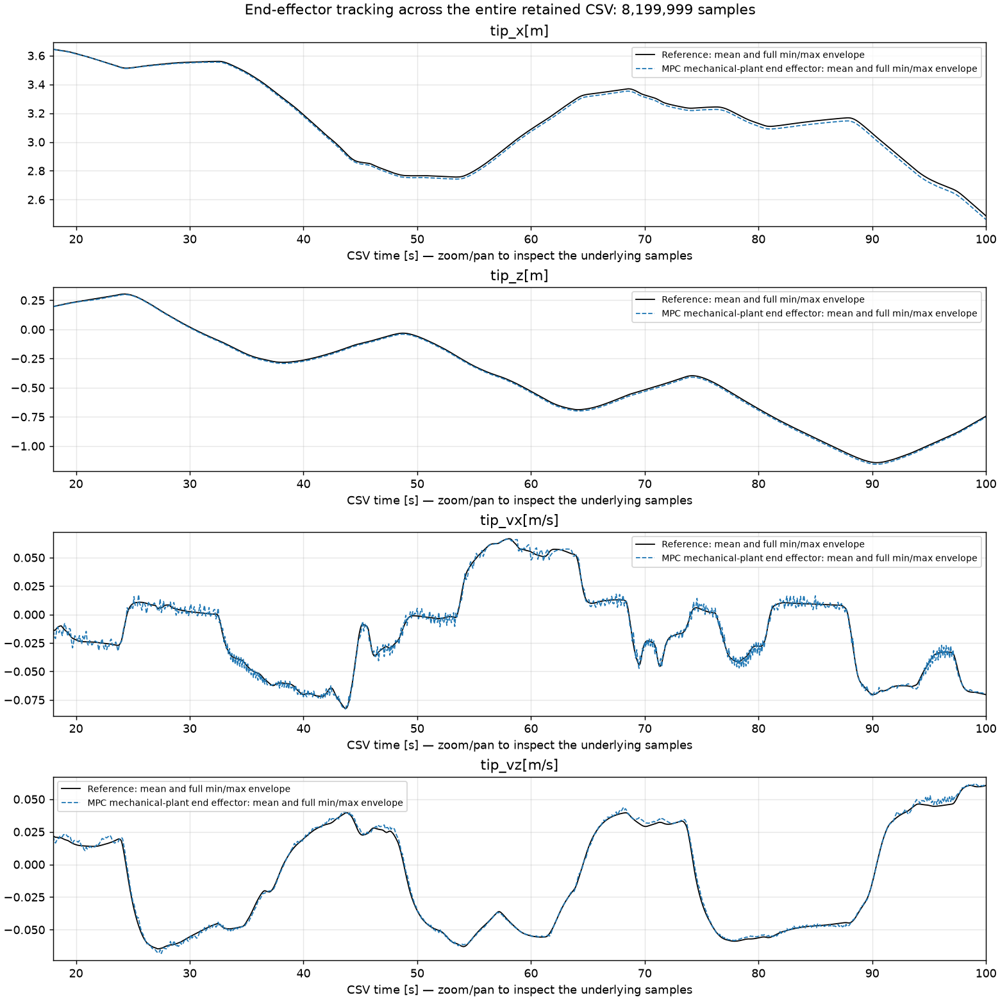

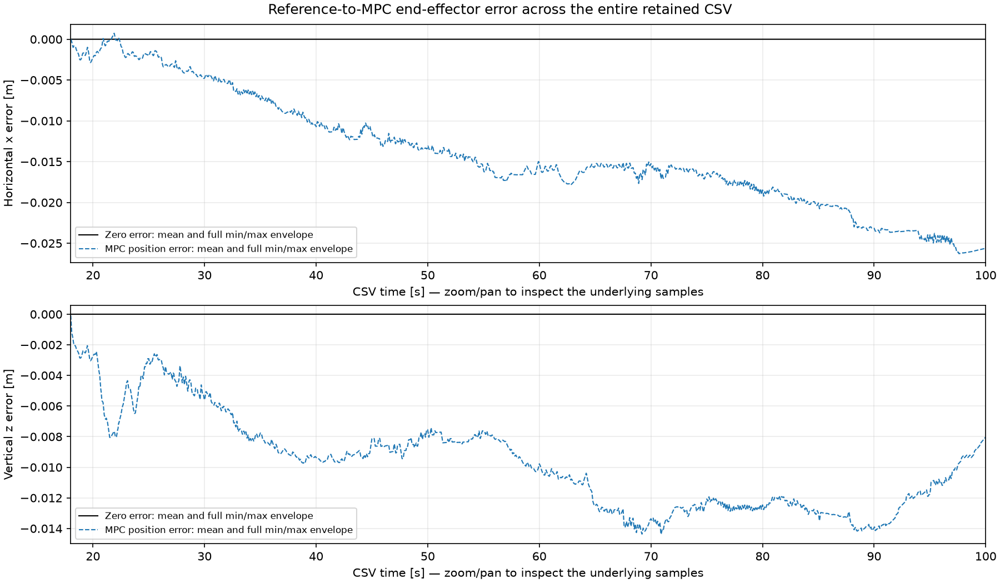

These are controlled-plant results, replacing the previously featured four-model
FK trajectory gallery. Every sample contributes to the plotted mean and min/max
envelope; x–z plots also retain per-bin bounding boxes. Full-resolution arrays
remain available, and interactive time plots load the visible samples when zoomed.

### Both booms, and each boom separately

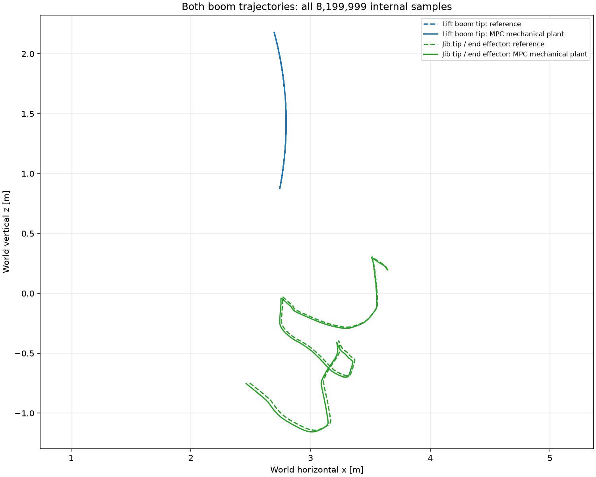

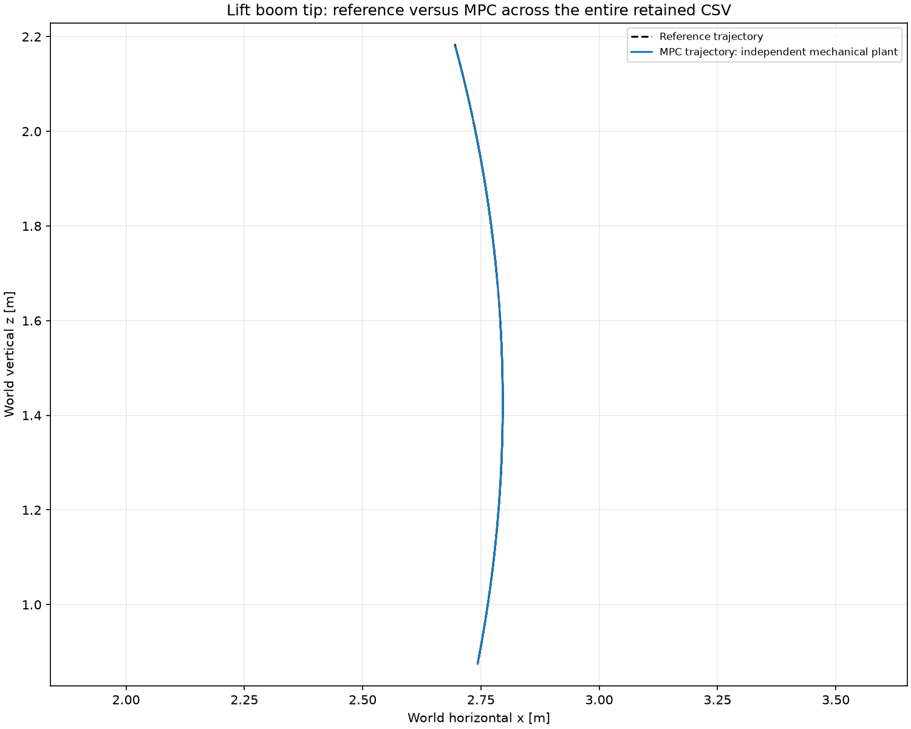

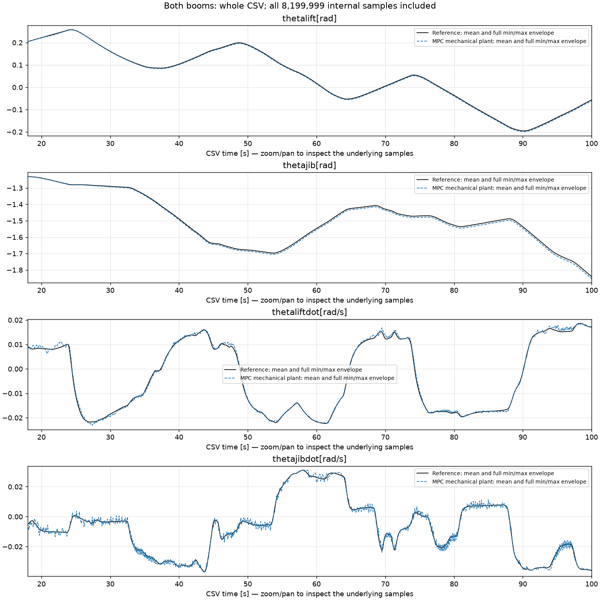

[Separate lift-state plot](docs/figures/mpc_lift_full_csv.png) ·
[separate jib-state plot](docs/figures/mpc_jib_full_csv.png).

### Measured MPC results

All metrics below use every internal 10-µs sample, excluding the two initialization
rows. Mechanical units are radians and rad/s; Cartesian units are metres and m/s.

| Mechanical state | RMSE | MAE | Max absolute error |
| --- | --- | --- | --- |
| thetalift[rad] | 0.002857286 | 0.002701339 | 0.004278567 |
| thetajib[rad] | 0.007663867 | 0.007032613 | 0.01234367 |
| thetaliftdot[rad/s] | 0.00061824 | 0.0004601342 | 0.00246762 |
| thetajibdot[rad/s] | 0.00130531 | 0.001000677 | 0.005680374 |

| End-effector state | RMSE | MAE | Max absolute error |
| --- | --- | --- | --- |
| tip_x[m] | 0.0156468 | 0.01402741 | 0.02627369 |
| tip_z[m] | 0.0101935 | 0.00971072 | 0.0144096 |
| tip_vx[m/s] | 0.002615065 | 0.002014383 | 0.0112743 |
| tip_vz[m/s] | 0.001865346 | 0.001388621 | 0.00774431 |

| Metric | Result |
| --- | --- |
| Euclidean tip position RMSE | 18.6743 mm |
| Euclidean tip position MAE | 17.2936 mm |
| Maximum tip position error | 28.0187 mm |
| Final tip position error | 26.8424 mm |
| Mean / median solve time | 1129.22 / 1121.34 ms |
| p95 solve time | 1193.29 ms |
| Optimizer success rate | 0.97561% |
| Solves exceeding the 100-ms interval | 100% |

This is an **offline learned-model mismatch experiment**. The measured solve times
do not establish real-time operation. The five-iteration limit and solver success
rate are reported explicitly: a finite selected candidate is not proof of a
converged optimizer. When an iteration limit is reached, the existing controller
uses its best finite bounded candidate, including the warm-start and hold-command
candidates. Tracking errors and GRU-versus-plant mismatch are saved separately.


[MPC summary and solver metrics](docs/results/mpc_full_csv_summary.json) ·
[all-sample mechanical tracking metrics](docs/results/mpc_full_csv_tracking_metrics.csv) ·
[all-sample end-effector metrics](docs/results/mpc_full_csv_end_effector_metrics.csv) ·
[reference reproduction diagnostic](docs/results/mpc_full_csv_reproduction_metrics.csv) ·
[coverage proof](docs/results/mpc_full_csv_recording_coverage.json).

## Prediction validation over 20 actual controller intervals

The stronger dynamics test uses the **actual 100-ms interval of the published
controller**, read from its saved configuration: **20 × 100 ms = 2 seconds**, or
**200,000 internal model steps**. This is separate from 20 internal samples
(0.2 ms) and 200 internal samples (2 ms). High R² in those tiny-horizon tests
does not establish predictive accuracy over an MPC-relevant duration.

All four models now have a recomputed **two-second recursive forecast test across
the entire retained CSV**: 8,199,999 targets each, 41 measured-reset blocks, and
199,999 predictions in the final partial block. Each block starts from two
measured rows and reset memory. There are no measured-state refreshes inside a
forecast block. Every retained target contributes to the global error metrics.

| Model | Lift angle RMSE [rad] | Jib angle RMSE [rad] | Lift velocity RMSE [rad/s] | Jib velocity RMSE [rad/s] |
| --- | --- | --- | --- | --- |
| GRU | 0.00267003 | 0.00419828 | 0.00434339 | 0.00561563 |
| LSTM | 0.00304465 | 0.00475421 | 0.00398889 | 0.00561928 |
| Transformer | 0.00340935 | 0.00841001 | 0.00503473 | 0.00952408 |
| Compact Recurrent | 0.00210751 | 0.00235846 | 0.00321849 | 0.0037923 |
| Hold initial measured state | 0.018517 | 0.0234549 | 0.00611215 | 0.00979436 |

The persistence baseline freezes all states at the initial measured row of each
two-second block. Errors are reported in physical units and relative to that
baseline. Angle R² can remain high because boom angle varies slowly across the
recording; angular velocity and pressure errors reveal additional limitations.
These results establish conditional predictive skill on this held-out recording,
not perfect model quality or general performance on other operating conditions.

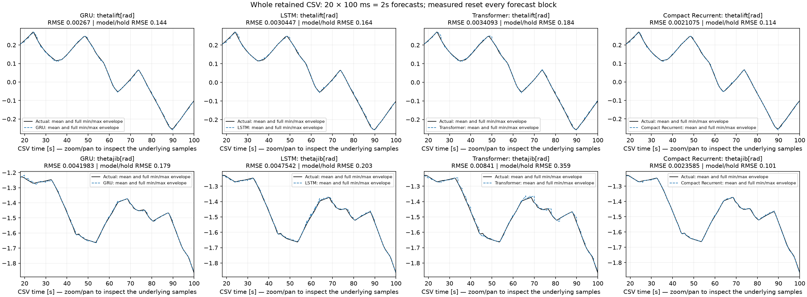

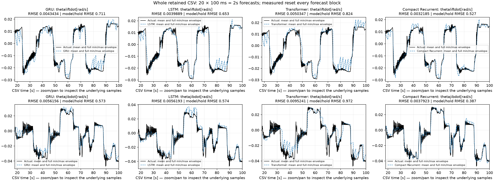

### Why the earlier plots looked perfect

| GRU forecast duration | Lift velocity RMSE [rad/s] | Lift velocity R? | Jib velocity RMSE [rad/s] | Jib velocity R? |
| --- | --- | --- | --- | --- |
| 20 internal samples: 0.2 ms | 3.390756e-06 | 0.999999953803 | 5.765094e-06 | 0.999999914737 |
| 200 internal samples: 2 ms | 3.282399e-05 | 0.999995670871 | 5.656502e-05 | 0.999991791858 |
| 20 controller intervals: 2 s | 0.004343389 | 0.924198934171 | 0.005615626 | 0.919100580508 |

These use the same checkpoint and recording. The shorter horizons have much less
time to accumulate error before a measured reset. Near-one R? at 0.2 or 2 ms
does not imply near-one R? over two seconds. [All models and states at all three
durations](docs/results/forecast_duration_comparison.csv) are saved for comparison.

### Error and persistence at every controller prediction interval

The first figure scores every internal sample within each 100-ms lead interval,
aggregated across all forecast blocks throughout the CSV. The second scores exact
100-ms endpoints at leads 1 through 20. An incomplete final interval is included
in all-sample metrics but excluded from exact-endpoint metrics: **819 exact
endpoints per model** are available, with 40 at the full two-second lead and 41
at each earlier lead. No target beyond the CSV is invented.

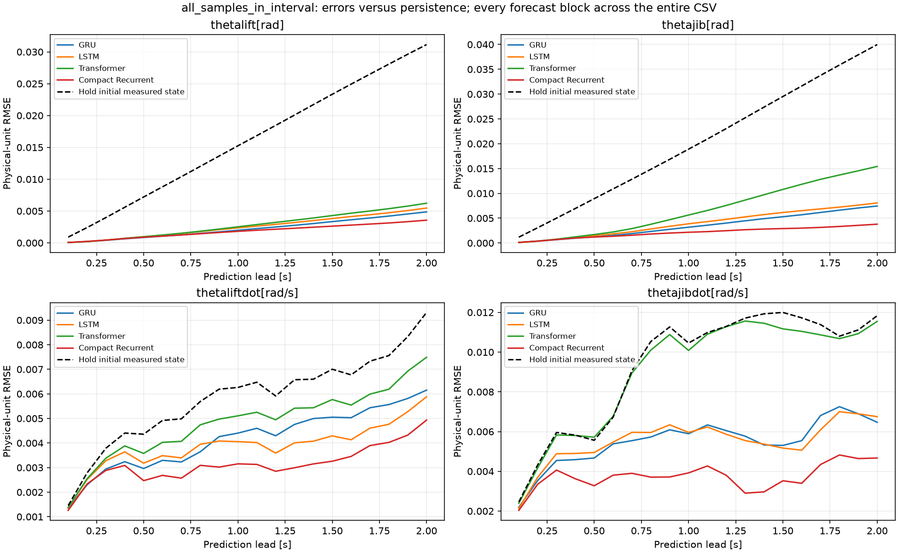

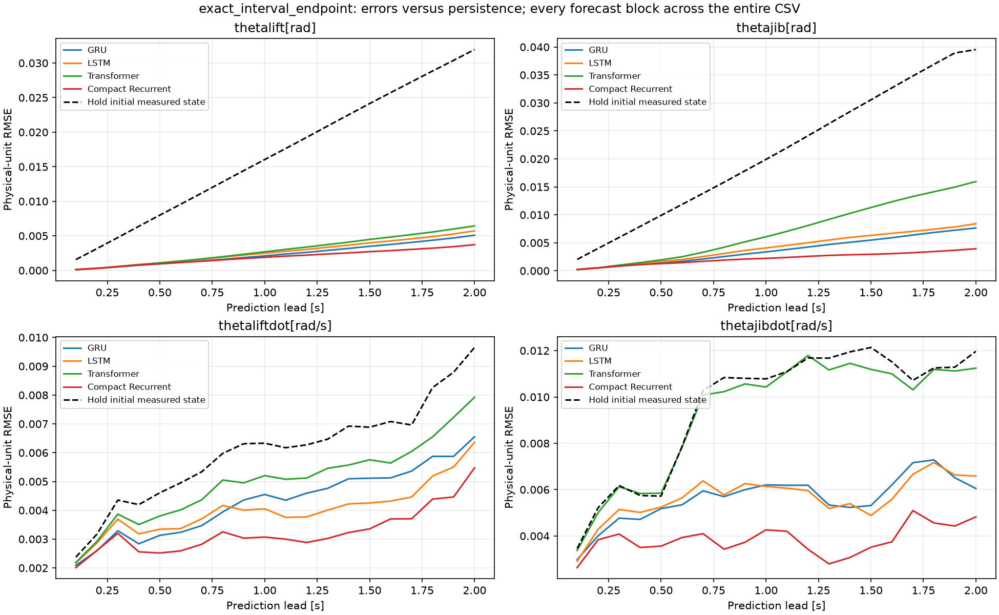

**Input assumption:** this test supplies the known recorded, preprocessed command
sequence at its original sample rate. It evaluates dynamics conditional on a
command preview, not the optimizer's ability to choose commands. Those commands
are not forced into 100-ms holds; forcing them into holds while scoring against
the original recording would also introduce command-approximation error. The
existing centered command smoothing remains offline preprocessing. This test
therefore does not establish deployment causality or closed-loop MPC tracking.

**Controller distinction:** the completed mechanical-plant MPC run above still
uses a two-interval, 200-ms planning horizon. This new 20-interval test does not
change that optimizer, its commands, its convergence rate or its measured tracking
results. The model-validation horizon and closed-loop controller experiment are
reported separately. The mechanical plant remains the only simulated MPC plant;
the four state-model forecasts are not four end-effector tracking experiments.

[All-state errors, R² and persistence](docs/results/controller20_all_state_metrics.csv) ·
[errors at all 20 intervals and exact endpoints](docs/results/controller20_metrics_by_interval.csv) ·
[model summary](docs/results/controller20_model_summary.csv) ·
[whole-CSV coverage](docs/results/controller20_recording_coverage.csv) ·
[duration, command assumption and checkpoint provenance](docs/results/controller20_protocol.json).

From the project root, with dataset paths configured:

```powershell
python evaluate_controller_horizon.py --controller-horizon 20 --saved-only
python compare_models.py --controller-config "MPC offline Model/results/full_csv_patu_100ms/config.json" --controller-horizon 20 --saved-only
```

The first command prints cached metrics and opens the complete-recording overviews
and persistence/lead plots. The second opens a separate full-recording figure for
each model/state. Omit `--saved-only` in the first command to compute missing
forecasts. Pass another completed controller's `--controller-config` to convert
its actual interval duration automatically. Add `--no-show` to save without GUI.

## Short-horizon diagnostic: 200 internal-step measured resets

| Setting | Value |
| --- | --- |
| Models | GRU, LSTM, Transformer, Compact Recurrent |
| Internal step | 10 µs |
| Prediction block before measured reset | 200 samples = 2 ms |
| Complete-CSV predictions per model | 8,199,999 |
| Reset blocks | 41,000 |
| Last block | 199 predictions |
| Reset | Two measured rows, with memory reset |
| Inside a block | Commands and predicted states; no future measured states |

The Transformer uses causal history, capped at its trained window. Its history
starts empty at each reset. All four evaluation kernels use native Numba float32
inference; physical metrics use reconstructed outputs. Normalization, targets and
reset boundaries match. Compact retains its historical different training
curriculum; this is not a claim of identical training objectives across all four.

| Model | Parameters | Mean NRMSE, all 22 states | Mean NRMSE, mechanics | 200-step median [µs] |
| --- | --- | --- | --- | --- |
| GRU | 4098 | 0.0003972997 | 0.001331286 | 297.9 |
| LSTM | 4946 | 0.0003988728 | 0.001339987 | 324.7 |
| Transformer | 4710 | 0.0004022796 | 0.001323912 | 2558.15 |
| Compact Recurrent | 4246 | 0.0003874854 | 0.00133942 | 250.6 |

Even 200 internal samples spans only **2 ms**. High R² is expected for slowly
moving boom states under frequent measurement resets and does not establish
long-horizon accuracy. Plots now display **1 − R² in scientific notation**,
instead of rounding near-one values to `1.000000`. Persistence RMSE and error by
prediction lead provide more useful context. A ratio of model RMSE to persistence
RMSE below one indicates improvement over holding the measured state fixed.

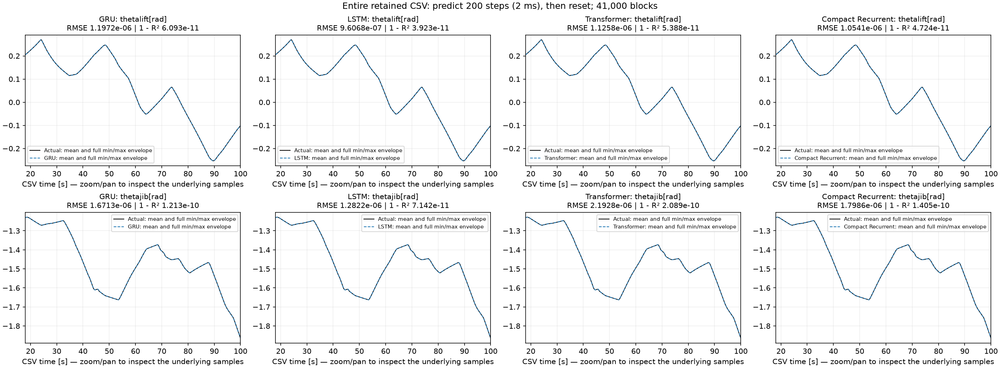

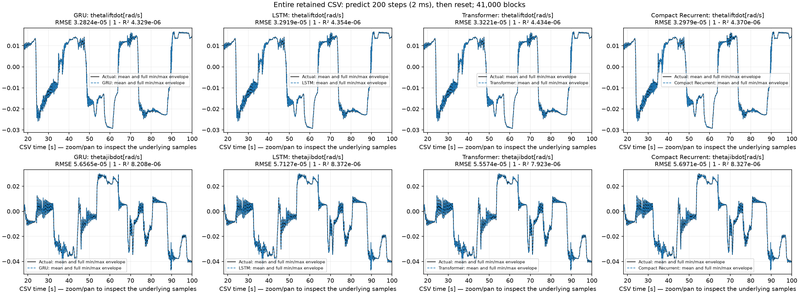

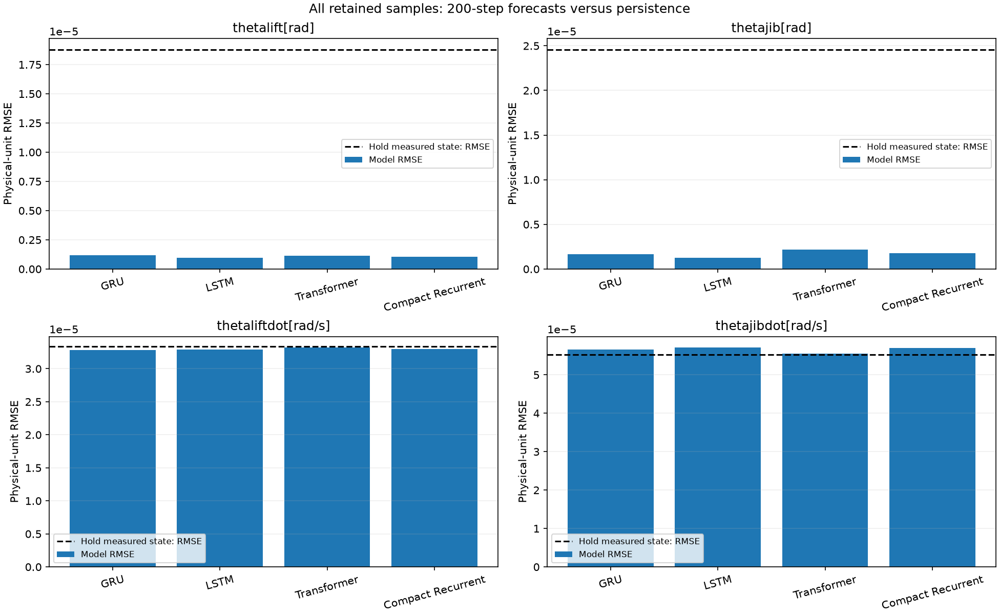

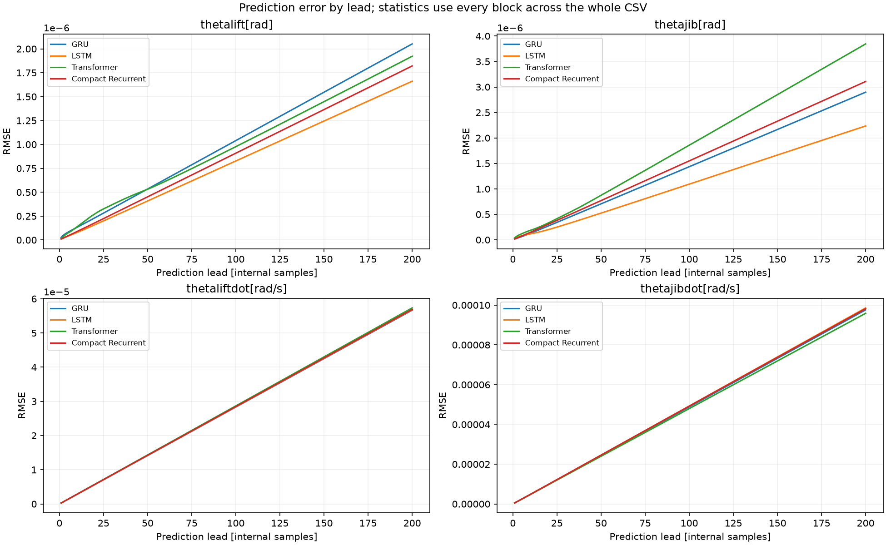

[All-state MAE, RMSE, R², 1−R², NRMSE and persistence](docs/results/reset200_all_state_metrics.csv) ·
[metrics by lead 1–200](docs/results/reset200_metrics_by_prediction_step.csv) ·
[model summary and timing](docs/results/reset200_model_summary.csv) ·
[complete-recording coverage](docs/results/reset200_recording_coverage.csv).

The four-model FK trajectory plots and reset-20 results remain as historical
diagnostics. They are not MPC tracking results and are no longer the main
trajectory figures in this README.

## Run, print metrics, and open the saved plots

Run these commands from the repository root after configuring the data paths.
The saved-result commands do not rerun inference or optimization.

```powershell
python compare_models.py --reinit-every 200 --saved-only
python summarize_comparison.py --reinit-every 200
python "MPC offline Model/offline_mpc.py" --plot-results "MPC offline Model/results/full_csv_patu_100ms"
```

The comparison opens a separate figure for each model/state. The MPC command
prints its metrics and opens the complete-recording reference/plant, end-effector,
both-boom, lift-only and jib-only plots. Windows remain open until closed.
Add `--no-show` to save without opening windows.

To recompute the model comparison over every retained sample:

```powershell
python "GRU Latent/test.py" --reinit-every 200
python "LSTM/test.py" --reinit-every 200
python "Transformers/test.py" --reinit-every 200
python "Compact Recurrent/test.py" --reinit-every 200
python compare_models.py --reinit-every 200 --saved-only
python summarize_comparison.py --reinit-every 200
```

Use `--reinit-every 100` to run the optional 1-ms, 100-sample comparison. Defaults
are now 200. A continuous autonomous rollout is explicit `--reinit-every 0` in an
individual model test. No training is required to change an evaluation horizon.

To repeat the completed full-CSV MPC experiment:

```powershell
python "MPC offline Model/offline_mpc.py" --full-recording --tracking-space cartesian --reference-mode plant-generated --block-steps 10000 --horizon 2 --moves 2 --maxiter 5 --output-dir "MPC offline Model/results/full_csv_patu_100ms" --overwrite
```

`--overwrite` archives the previous result folder. Controller `--horizon` counts
control intervals; comparison `--reinit-every` counts internal samples. The tested
100-ms command interval is explicitly configured here; the MPC script's older
1-ms default remains available and requires many more optimizer solves.

## PATU geometry, data, and artifacts

```text
base = (-0.09, 1.4261) m
lift_vector = (2.886080943, 0.019892554) m
jib_vector = (2.035, 0.245) m
p_elbow = base + R(theta_lift_absolute) @ lift_vector
p_tip = p_elbow + R(theta_jib_absolute) @ jib_vector
```

Both angles are absolute relative to the world horizontal. Full local vectors
include the geometric offsets; none are added again. Cartesian velocities use
the analytic Jacobian. The geometry is configured in
`MPC offline Model/geometry_patu.json`.

Raw recordings belong in `Train/` and `Test/`. Set `IMOTION_DATA_ROOT` to their
parent folder and `IMOTION_PREPROCESSED_DIR` to prepared arrays. Keep the existing
18-second trim and training-only normalization. The centered command smoothing
is retained as offline preprocessing consistent with the trained checkpoints.

Training entrypoints: `GRU Latent/gru.py`, `LSTM/LSTM.py`,
`Transformers/transformer.py`, `Compact Recurrent/trainCompactLatent.py`, and
`MPC offline Model/plant/trainMechanicalCompact.py`.
All four full-state artifacts and the 1,060-parameter mechanical artifact are
included. Large arrays and checkpoints use Git LFS. Run `git lfs pull` after
cloning to obtain them. No weights changed for these analyses.

[Dataset, preprocessing and training commands](docs/RUNNING.md) ·
[full-recording methodology](docs/FULL_RECORDING.md) ·
[Cartesian MPC and PATU geometry](docs/CARTESIAN_MPC.md).
