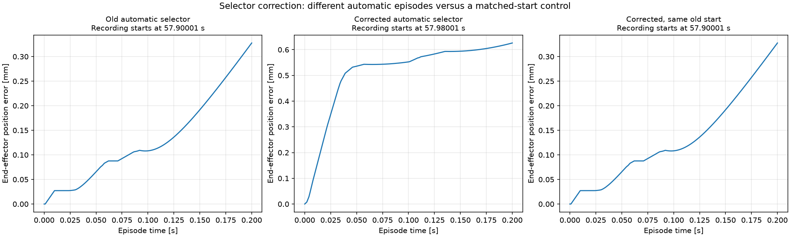

# Activity-selector denormalization: controlled before/after check

Prepared arrays are standardized. Physical velocity is `normalized * std + mean`.
The previous activity-selector expression, `normalized + mean/std`, is algebraically
`physical_velocity/std`. It therefore scores movement relative to each joint's
training standard deviation, not physical angular speed in rad/s. This could be
an intentional normalized-activity criterion if named as such; it was not a physical
velocity reconstruction. The production selector now explicitly uses physical speed.

The selector chooses the reference episode. It is not used to reconstruct the GRU's
predictions, and the trained weights, decoder, normalization, dynamics rollout,
kinematics, and MPC objective are unchanged by this correction.

## Actual closed-loop test

All three cases used the same held-out recording, trained GRU, independent mechanical
plant, PATU geometry, plant-generated reference mode, Cartesian objective, 0.2-second
episode, 1-ms control intervals (200 actions), 50-ms prediction horizon, five move
blocks, and eight SLSQP iterations maximum. Only the selector or explicit start changed.

| Selector/run | Recording start [s] | Position RMSE [mm] | Position MAE [mm] | Maximum error [mm] |
| --- | --- | --- | --- | --- |
| Old automatic selector | 57.90001 | 0.158009 | 0.131824 | 0.327610 |
| Corrected automatic selector | 57.98001 | 0.533768 | 0.514344 | 0.625932 |
| Corrected, same old start | 57.90001 | 0.158009 | 0.131824 | 0.327610 |



**Automatic-selection correction did not reduce tracking error in this test.**
It selected a different, more physically active episode. Comparing those two raw
RMSEs cannot establish a regression or improvement in the model itself.

With the start pinned to the old episode, commands, plant states, one-interval
predictions, complete predicted horizons, reference arrays, selected plans, and
objective costs were bitwise identical: maximum difference zero. This isolates
the effect to episode selection.

The old and corrected automatic jobs ran concurrently, so their solver timings
are not a controlled latency comparison. Tracking metrics and matched-start arrays
are the basis for the conclusion. These short runs are not a full one-second or
physical-crane validation. Per-axis velocity errors and R2, including negative
velocity R2, remain available in the CSV rather than being hidden behind position RMSE.

## What changes in the default one-second episode

The previous automatic start was retained time 39.15001 s (recording time 57.15001 s).
The corrected start is retained time 39.50001 s (recording time 57.50001 s).
Recorded-command RMS angular velocities, computed in rad/s, were approximately
(0.024570, 0.027351) for the old choice and (0.026649, 0.026565) for the corrected
choice. The corrected criterion finds more balanced physical movement. No one-second
closed-loop accuracy improvement is claimed from the short experiment.

## Reproduce and make future comparisons fair

From the portable project root, with the dataset paths configured:

```powershell
python "MPC offline Model/compare_activity_selection.py" --activity-rule old --tracking-space cartesian --reference-mode plant-generated --duration 0.2 --horizon-ms 50 --moves 5 --maxiter 8 --output-dir "MPC offline Model/results/ab_old_retest" --no-show
python "MPC offline Model/compare_activity_selection.py" --activity-rule physical --tracking-space cartesian --reference-mode plant-generated --duration 0.2 --horizon-ms 50 --moves 5 --maxiter 8 --output-dir "MPC offline Model/results/ab_physical_retest" --no-show
python "MPC offline Model/compare_activity_selection.py" --activity-rule physical --tracking-space cartesian --reference-mode plant-generated --duration 0.2 --horizon-ms 50 --moves 5 --maxiter 8 --start-seconds 39.90001 --output-dir "MPC offline Model/results/ab_fixed_retest" --no-show
```

`compare_activity_selection.py` changes only the selector in memory for the old
baseline; it does not put the old rule back into the production MPC script.
Each saved experiment includes `activity_selector_source.py` and a rule label
so the baseline override is auditable even though the controller source snapshot
is the corrected production script. For controller tuning, pin `--start-seconds`
or use `--segment-from` so the reference, initial state, and episode stay constant.
Improve tracking on that fixed benchmark rather than selecting whichever episode
happens to return a smaller RMSE. No retraining is required for this selector fix.

## Saved evidence

[Summary CSV](../MPC%20offline%20Model/results/activity_ab/summary.csv),
[per-axis RMSE/MAE/R2](../MPC%20offline%20Model/results/activity_ab/end_effector_axis_metrics.csv),
[segment-selection comparison](../MPC%20offline%20Model/results/activity_ab/segment_selection_comparison.csv),
and [matched-start verification](../MPC%20offline%20Model/results/activity_ab/matched_start_verification.json).

Native trajectories, command plans, model forecasts, solver histories, geometry,
and plots are saved under `MPC offline Model/results/activity_ab/` for all three cases.
