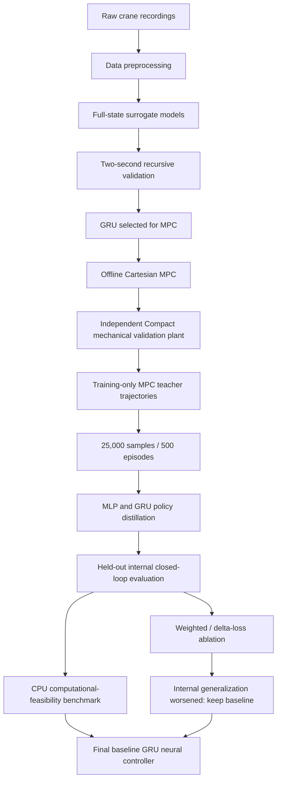

# Final research pipeline

The mechanical plant also generates reachable references before MPC solves; optimizer candidates use only the full-state predictor. Plant feedback advances after the chosen action. Policy own hidden memory is distinct from observer/predictor memory. External Test supports the earlier dynamics/MPC recording experiment; all teacher/policy stages use Train source recordings only.

Evidence: [experiment map](EXPERIMENT_MAP.md), [final neural results](results/neural_controller_results.csv), [full-recording MPC results](results/mpc_final_results.csv), [ablation](results/improvement_study_results.csv).
